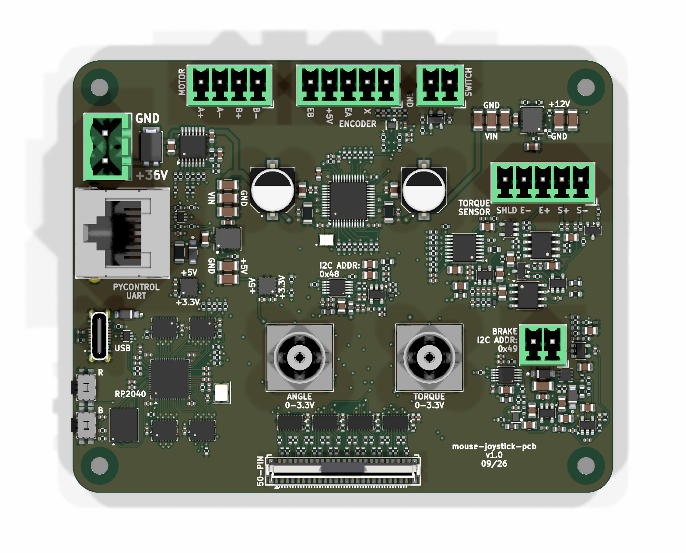
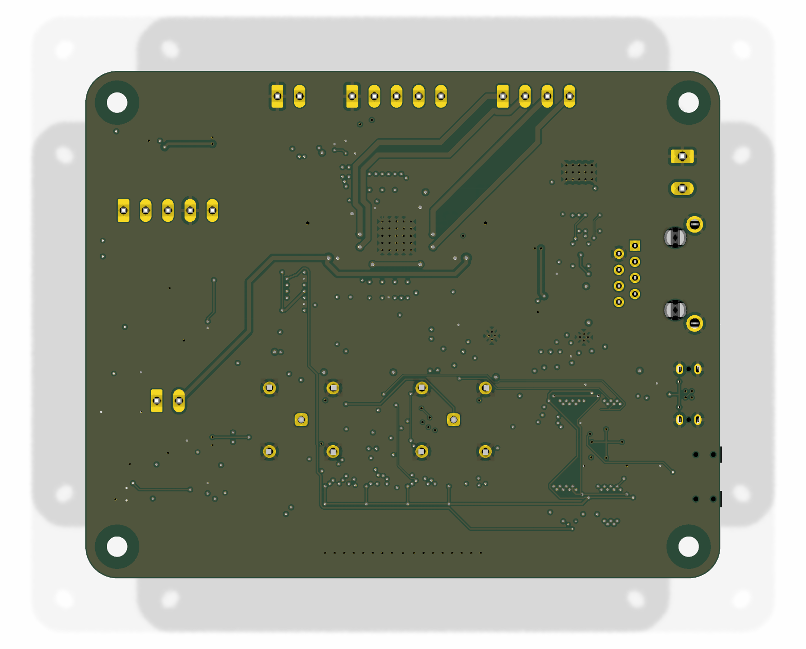
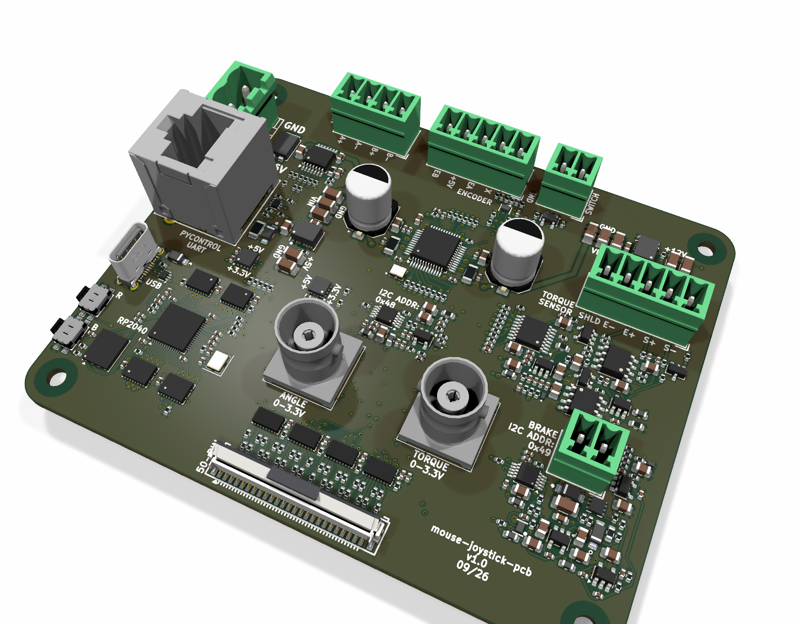
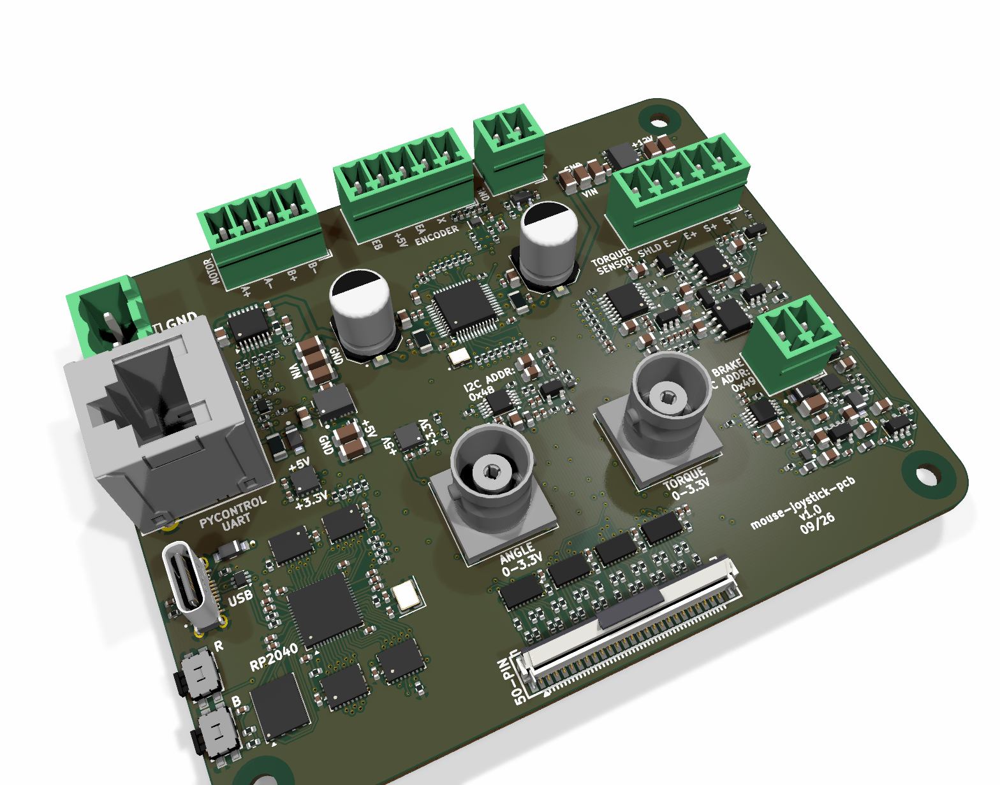
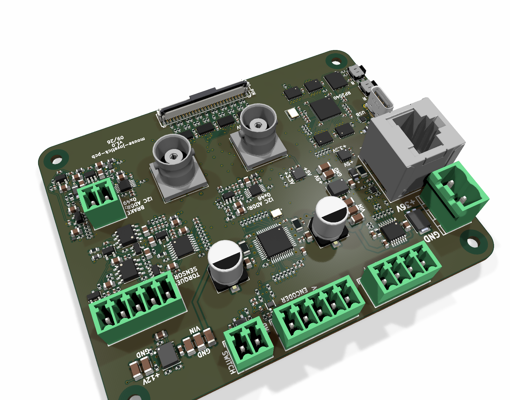
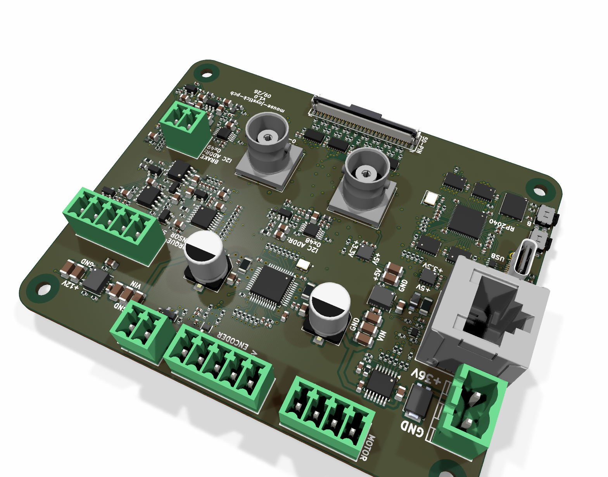
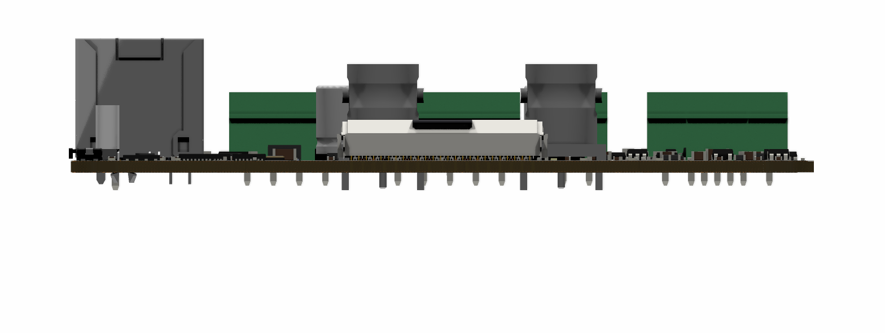
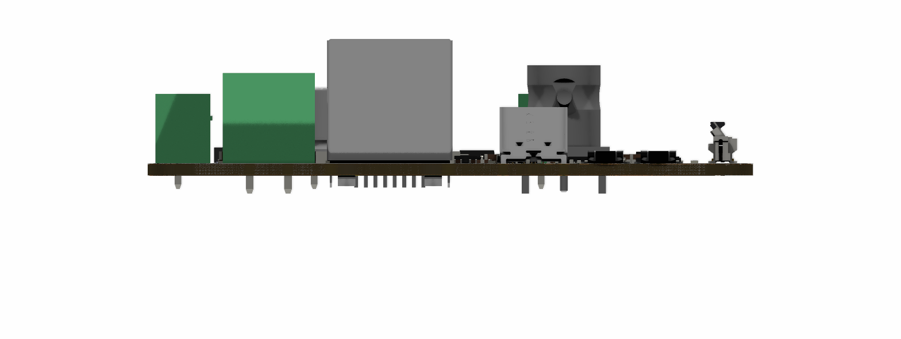

# mouse-joystick-pcb — Generated Board Documentation

Everything in this directory is generated by `orb-weaver-kicad-docs` from the
KiCad sources. Do not edit it by hand; run `make docs` instead.

- KiCad `10.0.6`
- Board `1099dc981dc3`

## Board At A Glance

| Property | Value |
| --- | --- |
| Outline | 100.0 × 80.0 mm, 5.0 mm corner radius |
| Thickness | 1.6 mm |
| Copper layers | 4 |
| Mounting holes | 4 × 3.2 mm |
| Connectors and controls | 13 |
| Bill of materials | 81 distinct parts, 360 placements |

## Assembled Board

### Top, straight down

### Bottom, straight down

### Isometric from the front left

### Isometric from the front right

### Isometric from the rear left

### Isometric from the rear right

### Front elevation, for connector heights

### Left elevation, for connector heights

## Documents

| Document | File |
| --- | --- |
| Schematic, all sheets, PDF | [mouse-joystick-pcb-schematic.pdf](schematic/mouse-joystick-pcb-schematic.pdf) |
| Schematic sheets, SVG (20) | [schematic/](schematic/) |
| Assembly view, top | [assembly-top.svg](layout/assembly-top.svg) |
| Assembly view, bottom | [assembly-bottom.svg](layout/assembly-bottom.svg) |
| Assembled board, STEP, for FreeCAD | [mouse-joystick-pcb-assembled.step](3d/mouse-joystick-pcb-assembled.step) |
| Bill of materials | [table](bom/mouse-joystick-pcb-bom.md) · [CSV](bom/mouse-joystick-pcb-bom.csv) |
| Board dimensions and stackup | [board-dimensions.md](mechanical/board-dimensions.md) |
| Board geometry, machine readable | [board-geometry.json](mechanical/board-geometry.json) |
| Mounting holes | [mounting-holes.csv](mechanical/mounting-holes.csv) |
| Connector locations | [connectors.csv](mechanical/connectors.csv) |

### Enclosure Reference

Millimetres from the **centre of the board outline**, X right and Y up,
looking at the top of the board. Extents are the part's courtyard, which is
what a panel cutout has to clear. Full tables in [board-dimensions.md](mechanical/board-dimensions.md).

**Mounting holes**

| Ref | X (mm) | Y (mm) | Drill (mm) |
| --- | --- | --- | --- |
| H101 | -45.0 | 35.0 | 3.2 |
| H102 | 45.0 | 35.0 | 3.2 |
| H103 | 45.0 | -35.0 | 3.2 |
| H104 | -45.0 | -35.0 | 3.2 |

**Connectors and controls**

| Ref | Part | X (mm) | Y (mm) | Rot | Extent X (mm) | Extent Y (mm) |
| --- | --- | --- | --- | --- | --- | --- |
| J201 | USB-C | -45.0 | -11.0 | 90.0 | -47.31 to -42.69 | -16.05 to -5.95 |
| J301 | RJ45-8P8C | -41.0 | 8.0 | 270.0 | -50.0 to -32.0 | -0.5 to 16.5 |
| J501 | TBH-1x02-5.08mm | -44.0 | 24.0 | 270.0 | -48.3 to -38.7 | 17.41 to 30.58 |
| J901 | Conn_Coaxial_HL-BNC-KHDA | 16.0 | -15.0 | 0.0 | 9.5 to 22.5 | -21.5 to -8.5 |
| J1101 | Conn_Coaxial_HL-BNC-KHDA | -8.0 | -15.0 | 180.0 | -14.5 to -1.5 | -21.5 to -8.5 |
| J1102 | TBH-1x04-3.5mm | -21.0 | 36.0 | 180.0 | -29.2 to -12.8 | 31.25 to 39.5 |
| J1103 | TBH-1x05-3.5mm | 1.0 | 36.0 | 180.0 | -8.95 to 10.95 | 31.25 to 39.5 |
| J1301 | FH12-50S-0.5SVA(54) | 0.0 | -36.0 | 180.0 | -14.75 to 14.75 | -38.8 to -33.2 |
| J1601 | TBH-1x02-3.5mm | 18.0 | 36.0 | 180.0 | 13.3 to 22.7 | 31.25 to 39.5 |
| J1801 | TBH-1x02-3.5mm | 37.0 | -12.0 | 180.0 | 32.3 to 41.7 | -16.75 to -8.5 |
| J2001 | TBH-1x05-3.5mm | 37.0 | 18.0 | 180.0 | 27.05 to 46.95 | 13.25 to 21.5 |
| SW601 | Switch_Tactile_SPST-NO_SMT_Side | -47.5 | -27.5 | 270.0 | -49.5 to -45.5 | -31.0 to -24.0 |
| SW602 | Switch_Tactile_SPST-NO_SMT_Side | -47.5 | -20.5 | 270.0 | -49.5 to -45.5 | -24.0 to -17.0 |

