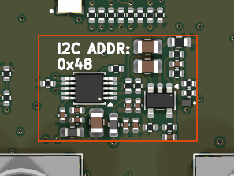

# analog_output_0_3v3_dac80501

<!-- Generated by orb-weaver-kicad-board-docs from board-manifest.yaml; do not edit. -->

Block `orb_weaver_private:analog_output_0_3v3_dac80501` placed in `/motor_encoder_switch` of **mouse-joystick-pcb**. Single-channel buffered 0-1.650 V precision analog voltage output, safe on a Neuropixels OneBox ADC channel or an unprotected 3.3 V MCU pin: a DAC80501ZDGSR at 3.3 V on I2C at address 0x48 on its internal 2.5 V reference, a 2-pole 987 Hz Sallen-Key reconstruction filter, an OPA197 on a ferrite-filtered 5 V rail at a non-inverting DC gain of 1.32 that is also the filter's active element, a /2 output divider, a 249 ohm series output resistor, an ESD clamp and a separately isolated monitor tap.

|  |  |
| --- | --- |
| Lifecycle | routed |
| Family | none (a private block) |
| Placement | anchor (-1, 2) mm, rotation 180°, front side |
| Sheet | `analog_output_0_3v3_dac80501.kicad_sch`; sheet pins: the board's own arrangement |
| Drawing | [mouse-joystick-pcb-motor_encoder_switch-analog_output_0_3v3_dac80501.svg](../schematic/mouse-joystick-pcb-motor_encoder_switch-analog_output_0_3v3_dac80501.svg) |

## On the Board

Block 13 of the [board view](../board-view.md): 16.4 × 10.9 mm on the top side, its centre 2.0 mm right of and 2.0 mm below the board centre (X right, Y up, as the enclosure tables); 28 footprints. The picture is the top render clipped around the block, the rectangle the extent of its footprints' courtyards.

## Description

Single-channel buffered 0-1.650 V precision analog voltage output, safe on a Neuropixels OneBox ADC channel or an unprotected 3.3 V MCU pin: a DAC80501ZDGSR at 3.3 V on I2C at address 0x48 on its internal 2.5 V reference, a 2-pole 987 Hz Sallen-Key reconstruction filter, an OPA197 on a ferrite-filtered 5 V rail at a non-inverting DC gain of 1.32 that is also the filter's active element, a /2 output divider, a 249 ohm series output resistor, an ESD clamp and a separately isolated monitor tap. AMP_VOUT full scale is 2.5 V x (1 + 3.2k/10k) = 3.300 V and AOUT is half of it, 1.650 V, LSB 25.2 uV. Built for the mouse-joystick-pcb encoder angle output, but THE CONNECTOR DELIBERATELY LIVES OUTSIDE THE BLOCK so one block serves any housing. The full derivation, values, retune ladder, layout rules and accuracy budget are in kicad-libs docs/analog-output-design.md; this note carries only what breaks silently without it. Designators are not stable (KiCad auto-annotation orders by sheet position), so everything below is named by net.
1. I2C, NOT SPI, AND THE ADDRESS IS ONE RESISTOR. SPI2C is strapped to +3.3V_FILT through 1k for I2C mode; A0 is strapped to GND through 1k for 0x48, and brake_current_sink_0_49ma_dac80501 takes 0x49. A0 is a FOUR-STATE pin (AGND 0x48, VDD 0x49, SDA 0x4A, SCL 0x4B), so a rail strap reaches only the first two. A0 is re-sampled during the first byte of EVERY frame, so a floating A0 gives an address that changes between frames rather than a clean failure; never lift that resistor without re-wiring it in the same operation.
2. THIS BLOCK OWNS NO BUS TERMINATIONS and must not gain any. An earlier revision advertised three 10k SPI idle resistors as a feature; they are DELETED, because two DAC blocks on one bus would put 5k to GND on SDA and SCL and idle the bus at 2.29 V against a 2.2k pull-up, on top of the DAC's 1.62 V VIH minimum. SCL and SDA leave as single-pin nets. The board fits ONE 2.2k pull-up pair PER BUS SEGMENT: the DAC-side pair on the SWITCHED 3.3 V rail, because an always-on pull-up reaching a DAC whose VDD is at 0 V exceeds the VDD+0.3 V digital-input absolute maximum and back-feeds +3.3V_FILT through the internal clamps; the MCU-side pair on the ALWAYS-ON rail, because the SN74CB3Q3245 is open by default.
3. AOUT AND AOUT_MON ARE TWO DIFFERENT PORTS AND CROSSING THEM IS A DEFECT ERC CANNOT CATCH. Both tap AOUT_DIV, the divider midpoint, so the monitor and the connector read the same voltage. AOUT is the delivered output and carries the 249 ohm source resistor and the ESD clamp; AOUT_MON is a 1k instrument tap. Both are validly driven either way round, so verify on the netlist that the clamp shares a net with the connector pin. Backwards leaves the human-accessible connector with NO ESD protection. This happened once, on mouse-joystick-pcb, 2026-08-27.
4. THE 100k OUTPUT PULL-DOWN STAYS ON AMP_VOUT, upstream of the /2 divider. It defines 0 V when the block is unpowered; on the midpoint it would parallel the bottom leg for about -1.6% of ratio, and it is a 1% 100ppm/C thick film against the divider's 0.1% 25ppm/C pair. General rule: anything whose job is to define a node when the amplifier is dead belongs on the AMP side of a divider; anything in parallel with a divider leg becomes part of the RATIO.
5. AOUT IS 0-1.650 V FROM A 1.849 kohm SOURCE AND NEEDS A >=1 Mohm LOAD. The source is the 249 ohm series resistor PLUS the divider's 1.6 kohm, not 249 ohm alone: against the OneBox AD7616-P's 1 Mohm that is -0.185% of gain, systematic and absorbed by per-board calibration, but a 100 kohm load costs -1.82% and a 50 ohm terminated input reads a fraction of the correct value. The 249 ohm still bounds a short of AOUT to ground at 6.6 mA and 11 mW inside a 62.5 mW 0402. The /2 divider is what bounds a single fault, including the amp's own output stage shorted to its 5 V rail, to 2.55 V on a connector pin, inside an STM32F405's 4.0 V absolute maximum. That bound is a property of the copper, not of a register write. The ESD clamp is a transient device and does NOT bound a DC fault.
6. THE FILTER IS NOT OPTIONAL, ITS CAPACITORS MUST BE C0G from one reel, AND SO MUST THE 470 pF DIVIDER MIDPOINT SHUNT. Class-2 dielectric is piezoelectric, this board is coupled to a stepper and a hand-driven joystick, and on the midpoint that pickup becomes signal. Retune by scaling BOTH series resistors by the same factor and leaving the capacitors alone: Q depends only on their ratio. Do not raise f0 to buy passband: rejection falls as (f0/20kHz)^2 and the chopper is the whole point. The 266 us group delay is a latency to MEASURE and report, and it is deliberately matched to torque_bridge_0_3v3_ina821's 263 us. The midpoint shunt is 470 pF because it adds only 0.75 us against that budget; the brake block's 10 nF would add 16 us and land the corner a decade above the 987 Hz filter.
7. FIRMWARE MUST WRITE GAIN (4h) = 0x0101 BEFORE ANY DATA WRITE, and at 3.3 V that is a SAFETY PROPERTY rather than a hazard. The reset default 0x0001 is out of spec against the 2.5 V internal reference at a 3.3 V VDD, so the reference alarm holds the output at 0 V until that write lands. This block used to run its DAC at 5 V, where the same default commanded 5 V x 1.32 and the amp clipped near 4.85 V into whatever was on the connector. Over I2C the alarm is also READABLE in STATUS, which is why this block is on I2C at all. Do not use REF-DIV=0 to recover the old span.
8. THE OUTPUT FLOOR IS 4.5 mV MEASURED, 2.25 mV AFTER THE DIVIDER. Map the valid signal range to start above it and reserve true 0 V as the out-of-band unhomed, faulted or unpowered level. That leaves only about 2 mV between a firmware-signalled fault and a dead output section, so STATUS, not the analog level, is the primary discriminator.
9. BIND +3.3V AND +5V TO THE SAME SWITCHED DOMAIN. Feed +5V from a REGULATED 5.0 V rail, never a diode-ORed host rail, so the output goes dark with its data source instead of holding a stale angle. The DAC's +3.3V MUST be the switched rail or it back-powers the switched domain through the DAC's input clamps.
10. PWR_FLAG ON BOTH +3.3V_FILT AND +5V_FILT is required: there are two ferrites and each breaks driver propagation. GND is flagged once at board level, not here.
11. TWO INSTANCES NEED SEPARATE SHEETS or their local nets merge, and DAC_A0 merging would silently put both copies on 0x48. A twin-axis board needs the SDA and SCL strap states, 0x4A and 0x4B, which a rail strap cannot reach.

## Ports

The brief's shape, edge, class and meaning for each port, then what the board wires it to.

| Port | Shape | Edge | Class | Wired to | Board net | Board class | GPIO | Meaning | On this board |
| --- | --- | --- | --- | --- | --- | --- | --- | --- | --- |
| `+3.3V` | passive | west | PWR_3V3_LOCAL | `+3.3V` | `/+3.3V_SW` | PWR_3V3 |  | DAC supply, the switched 3.3 V domain, through FB35002 to +3.3V_FILT (U35001 VDD); must be the switched rail or the DAC's input clamps back-power the domain. |  |
| `+5V` | passive | west | PWR_5V_LOCAL | `+5V` | `/+5V_SW` | PWR_5V |  | Amplifier supply, a regulated 5.0 V rail in the same switched domain, through FB35001 to +5V_FILT (U35002 V+, 4.5 V minimum). |  |
| `AOUT` | output | east | Default | `ANGLE_OUT` | `/motor_encoder_switch/ANGLE_OUT` | Default |  | Delivered output, 0-1.650 V from a 1.849 kohm source (R35009 plus the divider); needs a >= 1 Mohm load; ESD-clamped by D35001; any single fault is bounded to 2.55 V. |  |
| `AOUT_MON` | output | east | Default | `ANGLE_OUT_MON` | `/ANGLE_OUT_MON` | MCU_FINE | `GP29` | Monitor tap of AOUT_DIV through R35010 (1 k): the same 0-1.650 V as AOUT, isolated from it; an instrument reads here. | Analog output readback, ADC3¹¹; in as the MCU sees it |
| `GND` | passive | west | PWR_RETURN_LOCAL | `GND` | `/GND` | PWR_RETURN_LOCAL |  | Analog return of the DAC, amplifier, filter, divider and ESD clamp; flagged once at board level, not here. |  |
| `SCL` | input | west | Default | `DAC_SCL` | `/DAC_SCL` | Default | `GP17` | I2C clock to U35001 pin 6 (SCLK/SCL); leaves as a single-pin net, the board fits the pull-up. | I2C0 SCL — same bus⁷; out as the MCU sees it, via the bus switch |
| `SDA` | bidirectional | west | Default | `DAC_SDA` | `/DAC_SDA` | Default | `GP16` | I2C data, U35001 pin 8 (SDIN/SDA), address 0x48; leaves as a single-pin net, the board fits the pull-up. | I2C0 SDA — analog 0x48, brake 0x49⁷; bidi as the MCU sees it, via the bus switch |

## Parts

As placed on the board's sheet; 28 of 28 paired with the brief's references by symbol identity, the rest given the brief's role where the internal part has one, else the catalog's role slug; the placement is the `Placement` field of the board's symbol, else of the library's (D38); the manufacturer part and the LCSC number are the board's BOM's.

| Reference | Brief | Part | Value | Role | Placement | Manufacturer part | LCSC | DNP |
| --- | --- | --- | --- | --- | --- | --- | --- | --- |
| `C801` | `C35001` | `OW-PASS-CL05A105KL5NRNC` | 1uF | Rail bypass | beside U802.5 (V+), on +5V_FILT | CL05A105KL5NRNC | [C307413](https://www.lcsc.com/product-detail/C307413.html) |  |
| `C802` | `C35002` | `OW-PASS-CL21A106KOQNNNE` | 10uF | 3.3 V rail bulk bypass | beside U801.1 (VDD), on +3.3V_FILT | CL21A106KOQNNNE | [C1713](https://www.lcsc.com/product-detail/C1713.html) |  |
| `C803` | `C35003` | `OW-CAP-100N-0402-X5R-16V` | 100nF | U35002 V+ pin 5 bypass | beside U802.5 (V+), on +5V_FILT | GRM155R62A104KE14D | [C162178](https://www.lcsc.com/product-detail/C162178.html) |  |
| `C804` | `C35004` | `OW-PASS-CL05A105KL5NRNC` | 1uF | Rail bypass | beside U801.1 (VDD), on +3.3V_FILT | CL05A105KL5NRNC | [C307413](https://www.lcsc.com/product-detail/C307413.html) |  |
| `C805` | `C35005` | `OW-CAP-100N-0402-X5R-16V` | 100nF | U35001 VDD pin 1 bypass | beside U801.1 (VDD), on +3.3V_FILT | GRM155R62A104KE14D | [C162178](https://www.lcsc.com/product-detail/C162178.html) |  |
| `C806` | `C35006` | `OW-PASS-CL05A105KL5NRNC` | 1uF | Rail bypass | beside U802.5 (V+), on +5V_FILT | CL05A105KL5NRNC | [C307413](https://www.lcsc.com/product-detail/C307413.html) |  |
| `C807` | `C35007` | `OW-CAP-10N-0805-C0G-50V` | 10nF | Sallen-Key filter capacitors (C0G) |  | GRM2195C1H103JA01D | [C97905](https://www.lcsc.com/product-detail/C97905.html) |  |
| `C808` | `C35008` | `OW-CAP-100N-0402-X5R-16V` | 100nF | U35002 V+ pin 5 bypass | beside U802.5 (V+), on +5V_FILT | GRM155R62A104KE14D | [C162178](https://www.lcsc.com/product-detail/C162178.html) |  |
| `C809` | `C35009` | `OW-CAP-10N-0805-C0G-50V` | 10nF | Sallen-Key filter capacitors (C0G) | beside U802.3 (+), on DAC_VOUT_FILT | GRM2195C1H103JA01D | [C97905](https://www.lcsc.com/product-detail/C97905.html) |  |
| `C810` | `C35010` | `OW-PASS-GRM1555C1E100JA01D` | 10pF | Gain-network compensation |  | GRM1555C1E100JA01D | [C161512](https://www.lcsc.com/product-detail/C161512.html) |  |
| `C811` | `C35011` | `OW-PASS-GRT155R6YA474KE01D` | 0.47uF | VREFIO reference bypass | beside U801.10 (VREFIO), on VREFIO | GRT155R6YA474KE01D | [C711580](https://www.lcsc.com/product-detail/C711580.html) |  |
| `C812` | `C35012` | `OW-CAP-470P-0402-C0G-100V` | 470pF | AOUT_DIV midpoint shunt (C0G) |  | GRM1555C2A471JE01D | [C1518202](https://www.lcsc.com/product-detail/C1518202.html) |  |
| `D801` | `D35001` | `OW-MISC-TPD1E05U06DPYR` | TPD1E05U06DPYR | ESD clamp on AOUT |  | [TPD1E05U06DPYR](https://www.ti.com/lit/ds/symlink/tpd1e05u06.pdf) | [C436349](https://www.lcsc.com/product-detail/C436349.html) |  |
| `FB801` | `FB35001` | `OW-PASS-FCM1608KF-601T03` | 600R@100MHz | Rail ferrites | beside U802.5 (V+), on +5V_FILT | FCM1608KF-601T03 | [C141723](https://www.lcsc.com/product-detail/C141723.html) |  |
| `FB802` | `FB35002` | `OW-PASS-FCM1608KF-601T03` | 600R@100MHz | Rail ferrites | beside U801.1 (VDD), on +3.3V_FILT | FCM1608KF-601T03 | [C141723](https://www.lcsc.com/product-detail/C141723.html) |  |
| `R801` | `R35001` | `OW-RES-20K-0402-1PCT` | 20k | Filter series resistor, first |  | 0402WGF2002TCE | [C25765](https://www.lcsc.com/product-detail/C25765.html) |  |
| `R802` | `R35002` | `OW-RES-13K-0402-1PCT` | 13k | Filter series resistor, second |  | FRC0402F1302TS | [C2909319](https://www.lcsc.com/product-detail/C2909319.html) |  |
| `R803` | `R35003` | `OW-PASS-ERA2AEB103X` | 10k | Gain-set resistor, AMP_FB to GND | beside U802.4 (-), on AMP_FB | ERA2AEB103X | [C191915](https://www.lcsc.com/product-detail/C191915.html) |  |
| `R804` | `R35004` | `OW-PASS-RT0402BRD073K2L` | 3.2k | Gain feedback, U35002 (0.1 %) |  | RT0402BRD073K2L | [C705066](https://www.lcsc.com/product-detail/C705066.html) |  |
| `R805` | `R35005` | `OW-PASS-0603WAF1003T5E` | 100k | AMP_VOUT pull-down, unpowered 0 V | beside U802.1 (OUT), on AMP_VOUT | 0603WAF1003T5E | [C25803](https://www.lcsc.com/product-detail/C25803.html) |  |
| `R806` | `R35006` | `OW-PASS-RC0402FR-071KL` | 1k | A0 strap to GND, address 0x48 | beside U801.7 (SYNC/A0), on DAC_A0 | RC0402FR-071KL | [C106235](https://www.lcsc.com/product-detail/C106235.html) |  |
| `R807` | `R35007` | `OW-PASS-RT0402BRD073K2L` | 3.2k | /2 output divider top (0.1 %) |  | RT0402BRD073K2L | [C705066](https://www.lcsc.com/product-detail/C705066.html) |  |
| `R808` | `R35008` | `OW-PASS-RC0402FR-071KL` | 1k | SPI2C strap to VDD, I2C mode | beside U801.5 (SPI2C), on SPI2C | RC0402FR-071KL | [C106235](https://www.lcsc.com/product-detail/C106235.html) |  |
| `R809` | `R35009` | `OW-PASS-CRCW0402249RFKED` | 249 | Series output resistor |  | CRCW0402249RFKED | [C482112](https://www.lcsc.com/product-detail/C482112.html) |  |
| `R810` | `R35010` | `OW-PASS-RC0402FR-071KL` | 1k | Monitor tap isolation, AOUT_MON |  | RC0402FR-071KL | [C106235](https://www.lcsc.com/product-detail/C106235.html) |  |
| `R811` | `R35011` | `OW-PASS-RT0402BRD073K2L` | 3.2k | /2 output divider bottom (0.1 %) |  | RT0402BRD073K2L | [C705066](https://www.lcsc.com/product-detail/C705066.html) |  |
| `U801` | `U35001` | `OW-SENS-DAC80501ZDGSR` | DAC80501ZDGSR | 16-bit I2C DAC, internal 2.5 V reference |  | [DAC80501ZDGSR](https://www.ti.com/lit/ds/symlink/dac80501.pdf) | [C1852033](https://www.lcsc.com/product-detail/C1852033.html) |  |
| `U802` | `U35002` | `OW-MISC-OPA197IDBVR` | OPA197IDBVR | Filter and gain amplifier |  | [OPA197IDBVR](https://www.ti.com/lit/ds/symlink/opa197.pdf) | [C221351](https://www.lcsc.com/product-detail/C221351.html) |  |

## Operating Notes

- Signal path: U35001 VOUT (pin 2, 0-2.5 V on the internal reference) -> R35001 (20 k) -> DAC_VOUT_FILT_MID -> R35002 (13 k) -> DAC_VOUT_FILT -> U35002 + (pin 3). C35007 (10 nF, midpoint to AMP_VOUT) and C35009 (10 nF to GND) make a Sallen-Key low-pass with U35002 as the active element: f0 987 Hz, Q 0.61, group delay 266 us, matched to the torque block's 263 us. R35004 (3.2 k) over R35003 (10 k) sets the gain 1 + 3.2/10 = 1.32, so AMP_VOUT is 0-3.300 V; R35007 and R35011 (3.2 k each) halve it to AOUT_DIV, 0-1.650 V (LSB 25.2 uV); R35009 (249 ohm) delivers AOUT and R35010 (1 k) taps AOUT_MON.
- I2C, address 0x48: R35008 (1 k to +3.3V_FILT) latches SPI2C for I2C at power-up; R35006 (1 k to GND) sets A0 to 0x48 (the brake block takes 0x49). A0 is a four-state pin re-sampled during the first byte of every frame, so a floating A0 gives an address that changes between frames: never lift R35006 without re-wiring it in the same operation. The block owns no bus termination; SCL and SDA leave as single-pin nets and the board fits one 2.2 k pull-up pair per bus segment, the DAC-side pair on the switched 3.3 V rail.
- Firmware writes GAIN (4h) = 0x0101 before any DATA write. At a 3.3 V VDD the reset default is out of spec against the 2.5 V reference, so the reference alarm holds VOUT at 0 V until that write lands, and STATUS reports it over I2C. The measured output floor is 4.5 mV at AMP_VOUT, 2.25 mV at AOUT: map the signal range above it and keep 0 V for unpowered or faulted.
- Loading and fault bounds: AOUT needs a >= 1 Mohm load (-0.185 % of gain into 1 Mohm, -1.82 % into 100 kohm). R35009 bounds a short to ground at 6.6 mA; the /2 divider bounds any single fault, including U35002's output stuck at its 5 V rail, to 2.55 V at the connector. D35001 (TPD1E05U06, 5.5 V working, +-12 kV contact) clamps ESD transients only, not a DC fault. AOUT and AOUT_MON both tap AOUT_DIV and are electrically interchangeable: verify on the netlist that D35001 shares its net with the connector pin.
- Supplies: +5V from a regulated 5.0 V rail (U35002 needs 4.5 V) and +3.3V from the switched 3.3 V rail, both in the same switched domain so the output goes dark with its data source; FB35001 and FB35002 filter them to +5V_FILT and +3.3V_FILT, each carrying a PWR_FLAG. Two instances need separate sheets or DAC_A0, SPI2C and the filtered rails merge.
- C35007, C35009 and C35012 are C0G: class-2 dielectric is piezoelectric and this board is coupled to a stepper and a hand-driven joystick. Retune the filter by scaling R35001 and R35002 together; do not raise f0 and do not use C35010 for band limiting. R35005 (100 k) stays on AMP_VOUT, not on the midpoint, where it would become part of the ratio.

## Placement and Routing

### DAC and address straps

`U35001`, `R35006`, `R35008`, `C35011`, `FB35002`, `C35002`, `C35004`, `C35005`

U35001 generates 0-2.5 V on its internal reference; R35008 selects I2C, R35006 sets the address 0x48, C35011 bypasses VREFIO. FB35001 filters +5V to +5V_FILT for U35002 (C35001, C35003, C35006, C35008); FB35002 filters +3.3V to +3.3V_FILT for U35001 (C35002, C35004, C35005).

- Place: C35011 (0.47 uF; 150 nF or more is required) hard against pin 10 with the shortest return to pin 4 (AGND).
- Place: Silkscreen the address next to R35006.
- Place: C35003 and C35008 (100 nF) at U35002 pin 5 with the return at pin 2; C35005 (100 nF) at U35001 pin 1 with the return at pin 4; the 1 uF and 10 uF parts beside their ferrites.
- Route: SCL and SDA run straight from the ports to pins 6 and 8; no termination or tap inside the block (conventions 10 and 14: the shared I2C pulls are the board's).
- Route: +5V and +3.3V arrive at FB35001 and FB35002 pad 1 (PWR_5V_LOCAL and PWR_3V3_LOCAL vias, convention 1); the filtered rails stay inside the block.

### Reconstruction filter and gain amplifier

`R35001`, `R35002`, `C35007`, `C35009`, `U35002`, `R35003`, `R35004`, `C35010`, `FB35001`, `C35001`, `C35003`, `C35006`, `C35008`, `R35005`

R35001, R35002, C35007 and C35009 around U35002 form the 987 Hz Sallen-Key filter; R35003 and R35004 set the gain 1.32 and C35010 compensates the gain network. FB35001 filters +5V to +5V_FILT for U35002 (C35001, C35003, C35006, C35008); FB35002 filters +3.3V to +3.3V_FILT for U35001 (C35002, C35004, C35005).

- Place: Keep DAC_VOUT_FILT_MID and DAC_VOUT_FILT short and guarded by analog ground; R35003, R35004 and C35010 tight to U35002 pins 1 and 4.
- Place: Pull the ground pour back from under AMP_FB: C35010 compensates about 8 pF of input capacitance and plane capacitance there changes it.
- Place: C35003 and C35008 (100 nF) at U35002 pin 5 with the return at pin 2; C35005 (100 nF) at U35001 pin 1 with the return at pin 4; the 1 uF and 10 uF parts beside their ferrites.
- Route: DAC_VOUT, AMP_VOUT and VREFIO deserve their own netclass rather than Default.
- Route: +5V and +3.3V arrive at FB35001 and FB35002 pad 1 (PWR_5V_LOCAL and PWR_3V3_LOCAL vias, convention 1); the filtered rails stay inside the block.

### Output divider, series resistor and ESD clamp

`R35007`, `R35011`, `C35012`, `R35009`, `D35001`, `R35010`

R35007 and R35011 halve AMP_VOUT to AOUT_DIV; R35009 delivers AOUT with D35001 clamping it; R35010 isolates the AOUT_MON tap; R35005 defines AMP_VOUT at 0 V unpowered; C35012 shunts pickup on the midpoint.

- Place: Place the block at the connector: D35001's ground via must land on the connector ground pin, or connection inductance dominates its clamping.
- Place: C35012 at AOUT_DIV with a short return; R35007 and R35011 side by side (0.1 %, 25 ppm pair).
- Route: AOUT from R35009 to the connector pin that carries D35001; AOUT_MON through R35010 to its own via; keep the two apart.

## Library Identity

|  |  |
| --- | --- |
| Block | `orb_weaver_private:analog_output_0_3v3_dac80501` |
| Resolution | the placed id is in the library |
| Brief | `design_blocks/orb_weaver_private.kicad_blocks/analog_output_0_3v3_dac80501.kicad_block/analog_output_0_3v3_dac80501.brief.yaml`, the block's brief |
| Published sheet | `a144e9037996ddf8` |
| Published PCB | `b5ef1a929ebaacc2` |
| Source lock | symbol snapshot `793b65d3faee8d50`, published 2026-10-14 |
| Placed sheet | `4c14c278b5251f14`: matches the brief: its 28 parts by internal part, every port by name and shape; the file is the board's copy under its own designators |
| Netlist check | ok on 2026-10-15: every pin on the brief's net; 33 identity records differ, the board's own instances |

