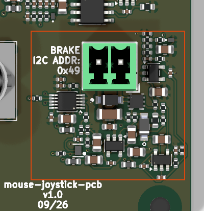

# brake_current_sink_0_49ma_dac80501

<!-- Generated by orb-weaver-kicad-board-docs from board-manifest.yaml; do not edit. -->

Block `orb_weaver_private:brake_current_sink_0_49ma_dac80501` placed in `/brake_torque_sensor` of **mouse-joystick-pcb**. DAC-programmed linear constant-current sink delivering 0-48.78 mA into a 24 V magnetic particle brake coil from a 36 V rail: a DAC80501ZDGSR at 3.3 V on I2C feeding a 0.19512 precision divider, an OPA197 integrating error amplifier on a ferrite-filtered 12 V rail driving a BUK7D36-60EX pass device over a 10 ohm Kelvin shunt, a second OPA197 as an independent 56.4 mA current ceiling that clamps the gate through a Schottky, a third as a 0-1.006 V ground-referenced current monitor behind a /2 output divider, an SN74LVC2G17 buffering the ceiling event out as active-low ~{BRAKE_FAULT}, and an S115Q flyback across the in-block 2-position 3.5 mm vertical coil terminal.

|  |  |
| --- | --- |
| Lifecycle | routed |
| Family | none (a private block) |
| Placement | anchor (37, 12) mm, rotation 180°, front side |
| Sheet | `brake_current_sink_0_49ma_dac80501.kicad_sch`; sheet pins: the board's own arrangement |
| Drawing | [mouse-joystick-pcb-brake_torque_sensor-brake_current_sink_0_49ma_dac80501.svg](../schematic/mouse-joystick-pcb-brake_torque_sensor-brake_current_sink_0_49ma_dac80501.svg) |

## On the Board

Block 14 of the [board view](../board-view.md): 24.4 × 23.7 mm on the top side, its centre 36.8 mm right of and 18.9 mm below the board centre (X right, Y up, as the enclosure tables); 54 footprints. The picture is the top render clipped around the block, the rectangle the extent of its footprints' courtyards.

## Description

DAC-programmed linear constant-current sink delivering 0-48.78 mA into a 24 V magnetic particle brake coil from a 36 V rail: a DAC80501ZDGSR at 3.3 V on I2C feeding a 0.19512 precision divider, an OPA197 integrating error amplifier on a ferrite-filtered 12 V rail driving a BUK7D36-60EX pass device over a 10 ohm Kelvin shunt, a second OPA197 as an independent 56.4 mA current ceiling that clamps the gate through a Schottky, a third as a 0-1.006 V ground-referenced current monitor behind a /2 output divider, an SN74LVC2G17 buffering the ceiling event out as active-low ~{BRAKE_FAULT}, and an S115Q flyback across the in-block 2-position 3.5 mm vertical coil terminal. The full derivation, connection table, BOM and open items are in kicad-libs docs/brake-current-sink-design.md; this note carries only what breaks silently without it. Designators are not stable (KiCad auto-annotation orders by sheet position), so everything below is named by net.
1. I2C, NOT SPI, AND THE ADDRESS IS ONE RESISTOR. SPI2C is strapped to +3.3V_FILT through 1k for I2C mode; A0 is strapped to +3.3V_FILT through 1k for 0x49, and analog_output_0_3v3_dac80501 takes 0x48. A0 is a FOUR-STATE pin (AGND 0x48, VDD 0x49, SDA 0x4A, SCL 0x4B), so a rail strap reaches only the first two. A0 is re-sampled during the first byte of EVERY frame, so a floating A0 gives an address that changes between frames rather than a clean failure; never lift that resistor without re-wiring it in the same operation.
2. THIS BLOCK OWNS NO BUS TERMINATIONS and must not gain any. SCL and SDA leave as single-pin nets. The board fits ONE 2.2k pull-up pair PER BUS SEGMENT: the DAC-side pair on the SWITCHED 3.3 V rail, because an always-on pull-up reaching a DAC whose VDD is at 0 V exceeds the VDD+0.3 V digital-input absolute maximum and back-feeds +3.3V_FILT through the internal clamps; the MCU-side pair on the ALWAYS-ON rail, because the SN74CB3Q3245 is open by default. Two instances each carrying pull-ups would halve the resistance.
3. THE 110k OUTPUT PULL-DOWN STAYS ON ISENSE_OUT, upstream of the /2 divider. On the midpoint it parallels the bottom leg (110k||3.2k = 3.1095k, ratio 0.49283, -1.43%) and it is a 1% 100ppm/C thick film against the divider's 0.1% 25ppm/C pair, so it would dominate the ratio's whole error budget. General rule: anything whose job is to define a node when the amplifier is dead belongs on the AMP side of a divider; anything in parallel with a divider leg becomes part of the RATIO.
4. BRAKE_ISENSE IS 0-1.006 V FROM A 1.849 kohm SOURCE AND NEEDS A >=1 Mohm LOAD. The /2 divider is what bounds a single fault, including the monitor amp stuck at its own +5V_FILT rail, to 2.48 V on a connector pin; the 249 ohm series resistor's input end is on ISENSE_DIV, downstream of the divider, never on ISENSE_OUT. A ceiling event reads 1.163 V, deliberately ABOVE full scale, so a limit event stays visible. 0 V means unpowered or dead, not zero current.
5. ~{BRAKE_FAULT} IS A SWITCHED-DOMAIN OUTPUT WITH Ioff, so it is high-Z whenever +3.3V_FILT is down and THE PLACING BOARD OWES THE MCU-SIDE TERMINATION, a 10k pull-down to GND, which means the line reads ASSERTED whenever the switched rail is off. Firmware must only interpret it while the rail is known up. It is a continuous limiter indication, not a latch. Do not substitute the 2G14; it is the inverter.
6. FIRMWARE MUST WRITE GAIN (4h) = 0x0101 BEFORE ANY DATA WRITE. At 3.3 V the reset default 0x0001 is out of spec against the 2.5 V internal reference, so the reference alarm holds the output at 0 V until that write lands. That is a safety property, not a bug, and over I2C the alarm is READABLE in STATUS, which is why this block is on I2C at all.
7. THE FOUR 10 nF FILTER AND COMPENSATION CAPACITORS MUST BE C0G, not X7R or X5R, and so must the divider midpoint's 10 nF. Class-2 dielectric is piezoelectric, this board is mechanically coupled to a stepper and a hand-driven joystick, and 1 mV on V_SET is 0.1 mA of coil current. A mechanically generated torque artifact in a torque measurement cannot be filtered out. C0G at 10 nF forces an 0805 body; take the area.
8. V_LIMIT STAYS 5 V-DERIVED AND THE GATE DRIVE STAYS 12 V. Moving V_LIMIT to 12 V rescales the 564 mV ceiling threshold; moving the loop amp back to 5 V leaves 90 mV of worst-corner gate-drive margin with a -7.5 mV/degC tempco.
9. PWR_FLAG on +12V_FILT, +5V_FILT and +3.3V_FILT is required: the ferrites break driver propagation. GND is flagged once at board level, not here.
10. TWO INSTANCES NEED SEPARATE SHEETS or their local nets merge: +12V_FILT, +5V_FILT, +3.3V_FILT, V_SET, V_SENSE, V_LIMIT, ISENSE_DIV, GATE, SPI2C and DAC_A0. The ferrites parallel, the PWR_FLAGs conflict, and DAC_A0 merging would silently put both DACs on one address.

## Ports

The brief's shape, edge, class and meaning for each port, then what the board wires it to.

| Port | Shape | Edge | Class | Wired to | Board net | Board class | GPIO | Meaning | On this board |
| --- | --- | --- | --- | --- | --- | --- | --- | --- | --- |
| `+3.3V` | passive | west | PWR_3V3_LOCAL | `+3.3V` | `/+3.3V_SW` | PWR_3V3 |  | Switched 3.3 V: DAC and fault-buffer supply through FB36003 to +3.3V_FILT; the reference of both mode straps. |  |
| `+5V` | passive | west | PWR_5V_LOCAL | `+5V` | `/+5V_SW` | PWR_5V |  | Regulated 5.0 V for the ceiling and monitor amplifiers and the V_LIMIT divider, through FB36002 to +5V_FILT (OPA197 minimum 4.5 V). |  |
| `+12V` | passive | west | PWR_12V_LOCAL | `+12V` | `/brake_torque_sensor/+12V` | PWR_12V_LOCAL |  | Gate-drive supply of the loop amplifier U36002, through FB36001 to +12V_FILT. |  |
| `+36V` | passive | west | PWR_HV_LOCAL | `+36V` | `/+36V_SW` | PWR_HV_BUS |  | Coil supply, switched domain: J36001 pin 2 and the flyback cathode of D36002, bypassed by C36017 and C36018; the pass device drops what the coil does not. |  |
| `BRAKE_ISENSE` | output | east | Default | `BRAKE_ISENSE` | `/BRAKE_ISENSE` | MCU_FINE | `GP27` | Current monitor, 0-1.006 V for 0-48.78 mA from a 1.849 kohm source; needs a >= 1 Mohm load; a ceiling event reads 1.163 V; 0 V means unpowered. | Brake sink current readback, ADC1¹¹; in as the MCU sees it |
| `GND` | passive | west | PWR_RETURN_LOCAL | `GND` | `/GND` | PWR_RETURN_LOCAL |  | Return of the shunt R36016, the amplifiers, the DAC and the bypass; the brake return joins board ground once, at the power-stage return point. |  |
| `SCL` | input | west | Default | `DAC_SCL` | `/DAC_SCL` | Default | `GP17` | I2C clock to U36001 pin 6 (SCLK/SCL); single-pin net, the board fits the pull-up. | I2C0 SCL — same bus⁷; out as the MCU sees it, via the bus switch |
| `SDA` | bidirectional | west | Default | `DAC_SDA` | `/DAC_SDA` | Default | `GP16` | I2C data, U36001 pin 8 (SDIN/SDA), address 0x49; single-pin net, the board fits the pull-up. | I2C0 SDA — analog 0x48, brake 0x49⁷; bidi as the MCU sees it, via the bus switch |
| `~{BRAKE_FAULT}` | output | east | Default | `~{BRAKE_FAULT}` | `/~{BRAKE_FAULT}` | Default | `GP13` | Active-low continuous limiter indication from U36003 1Y; high-Z (Ioff) whenever +3.3V_FILT is down, so the board owes a 10 k pull-down to GND. | Brake block fault, active low⁷; in as the MCU sees it, via the bus switch |
| `~{BRAKE_FAULT}_INST` | output | east | INSTRUMENT | `~{BRAKE_FAULT}_INST` | `/~{BRAKE_FAULT}_INST` | INSTRUMENT |  | Instrument tap of ~{BRAKE_FAULT} through R36020 (1 k); INSTRUMENT class. |  |

## Parts

As placed on the board's sheet; 54 of 54 paired with the brief's references by symbol identity, the rest given the brief's role where the internal part has one, else the catalog's role slug; the placement is the `Placement` field of the board's symbol, else of the library's (D38); the manufacturer part and the LCSC number are the board's BOM's.

| Reference | Brief | Part | Value | Role | Placement | Manufacturer part | LCSC | DNP |
| --- | --- | --- | --- | --- | --- | --- | --- | --- |
| `C1801` | `C36001` | `OW-CAP-10N-0805-C0G-50V` | 10nF | Monitor input filter, ISENSE_IN (C0G) | beside U1804.3 (+), on ISENSE_IN | GRM2195C1H103JA01D | [C97905](https://www.lcsc.com/product-detail/C97905.html) |  |
| `C1802` | `C36002` | `OW-PASS-CL21A106KOQNNNE` | 10uF | Rail bulk bypass | beside U1802.5 (V+), on +12V_FILT | CL21A106KOQNNNE | [C1713](https://www.lcsc.com/product-detail/C1713.html) |  |
| `C1803` | `C36003` | `OW-PASS-CL21A106KOQNNNE` | 10uF | Rail bulk bypass |  | CL21A106KOQNNNE | [C1713](https://www.lcsc.com/product-detail/C1713.html) |  |
| `C1804` | `C36004` | `OW-PASS-CL21A106KOQNNNE` | 10uF | Rail bulk bypass |  | CL21A106KOQNNNE | [C1713](https://www.lcsc.com/product-detail/C1713.html) |  |
| `C1805` | `C36005` | `OW-CAP-100N-0402-X5R-16V` | 100nF | U36002 V+ pin 5 bypass | beside U1802.5 (V+), on +12V_FILT | GRM155R62A104KE14D | [C162178](https://www.lcsc.com/product-detail/C162178.html) |  |
| `C1806` | `C36006` | `OW-CAP-100N-0402-X5R-16V` | 100nF | U36006 V+ pin 5 bypass | beside U1806.5 (V+), on +5V_FILT | GRM155R62A104KE14D | [C162178](https://www.lcsc.com/product-detail/C162178.html) |  |
| `C1807` | `C36007` | `OW-CAP-100N-0402-X5R-16V` | 100nF | U36001 VDD pin 1 bypass | beside U1801.1 (VDD), on +3.3V_FILT | GRM155R62A104KE14D | [C162178](https://www.lcsc.com/product-detail/C162178.html) |  |
| `C1808` | `C36008` | `OW-CAP-10N-0805-C0G-50V` | 10nF | Command filter, V_SET (C0G) | beside U1802.3 (+), on V_SET | GRM2195C1H103JA01D | [C97905](https://www.lcsc.com/product-detail/C97905.html) |  |
| `C1809` | `C36009` | `OW-CAP-100N-0402-X5R-16V` | 100nF | +5V_FILT bypass at R36011, V_LIMIT top |  | GRM155R62A104KE14D | [C162178](https://www.lcsc.com/product-detail/C162178.html) |  |
| `C1810` | `C36010` | `OW-CAP-100N-0402-X5R-16V` | 100nF | U36001 VDD pin 1 bypass | beside U1801.1 (VDD), on +3.3V_FILT | GRM155R62A104KE14D | [C162178](https://www.lcsc.com/product-detail/C162178.html) |  |
| `C1811` | `C36011` | `OW-PASS-GRT155R6YA474KE01D` | 0.47uF | VREFIO reference bypass | beside U1801.10 (VREFIO), on VREFIO | GRT155R6YA474KE01D | [C711580](https://www.lcsc.com/product-detail/C711580.html) |  |
| `C1812` | `C36012` | `OW-CAP-10N-0805-C0G-50V` | 10nF | Loop integrator, U36002 (C0G) |  | GRM2195C1H103JA01D | [C97905](https://www.lcsc.com/product-detail/C97905.html) |  |
| `C1813` | `C36013` | `OW-CAP-100N-0402-X5R-16V` | 100nF | U36004 V+ pin 5 bypass | beside U1804.5 (V+), on +5V_FILT | GRM155R62A104KE14D | [C162178](https://www.lcsc.com/product-detail/C162178.html) |  |
| `C1814` | `C36014` | `OW-CAP-100N-0402-X5R-16V` | 100nF | U36003 VCC pin 5 bypass | beside U1803C.5 (VCC), on +3.3V_FILT | GRM155R62A104KE14D | [C162178](https://www.lcsc.com/product-detail/C162178.html) |  |
| `C1815` | `C36015` | `OW-CAP-10N-0805-C0G-50V` | 10nF | ISENSE_DIV midpoint shunt (C0G) |  | GRM2195C1H103JA01D | [C97905](https://www.lcsc.com/product-detail/C97905.html) |  |
| `C1816` | `C36016` | `OW-CAP-100N-0402-X5R-16V` | 100nF | V_LIMIT reference bypass | beside U1806.3 (+), on V_LIMIT | GRM155R62A104KE14D | [C162178](https://www.lcsc.com/product-detail/C162178.html) |  |
| `C1817` | `C36017` | `OW-CAP-470N-1206-X7R-100V` | 470nF | +36V coil rail bypass |  | CGA1206X7R474K101NT | [C6119998](https://www.lcsc.com/product-detail/C6119998.html) |  |
| `C1818` | `C36018` | `OW-PASS-GRM188R72A104KA35D` | 100nF | +36V coil rail HF bypass |  | GRM188R72A104KA35D | [C77058](https://www.lcsc.com/product-detail/C77058.html) |  |
| `C1819` | `C36019` | `OW-PASS-GRM1555C1E100JA01D` | 10pF | Monitor amplifier compensation |  | GRM1555C1E100JA01D | [C161512](https://www.lcsc.com/product-detail/C161512.html) |  |
| `C1820` | `C36020` | `OW-CAP-10N-0805-C0G-50V` | 10nF | Ceiling integrator, U36006 (C0G) |  | GRM2195C1H103JA01D | [C97905](https://www.lcsc.com/product-detail/C97905.html) |  |
| `D1801` | `D36001` | `OW-MISC-MBR120VLSFT1G` | MBR120VLSFT1G | Gate clamp steering diode |  | [MBR120VLSFT1G](https://www.onsemi.com/pdf/datasheet/mbr120vlsft1-d.pdf) | [C223608](https://www.lcsc.com/product-detail/C223608.html) |  |
| `D1802` | `D36002` | `OW-MISC-S115Q` | S115Q | Coil flyback Schottky | beside U1805 D pins 1, 2, 5, 6, 7 (one per pin), on COIL_LO | [S115Q](https://www.lcsc.com/product-detail/C5362393.html) | [C5362393](https://www.lcsc.com/product-detail/C5362393.html) |  |
| `D1803` | `D36003` | `OW-MISC-TPD1E05U06DPYR` | TPD1E05U06DPYR | ESD clamp on BRAKE_ISENSE |  | [TPD1E05U06DPYR](https://www.ti.com/lit/ds/symlink/tpd1e05u06.pdf) | [C436349](https://www.lcsc.com/product-detail/C436349.html) |  |
| `FB1801` | `FB36001` | `OW-PASS-FCM1608KF-601T03` | 600R@100MHz | Rail ferrites | beside U1802.5 (V+), on +12V_FILT | FCM1608KF-601T03 | [C141723](https://www.lcsc.com/product-detail/C141723.html) |  |
| `FB1802` | `FB36002` | `OW-PASS-FCM1608KF-601T03` | 600R@100MHz | Rail ferrites |  | FCM1608KF-601T03 | [C141723](https://www.lcsc.com/product-detail/C141723.html) |  |
| `FB1803` | `FB36003` | `OW-PASS-FCM1608KF-601T03` | 600R@100MHz | Rail ferrites |  | FCM1608KF-601T03 | [C141723](https://www.lcsc.com/product-detail/C141723.html) |  |
| `J1801` | `J36001` | `OW-CONN-TBH-1X02-3P5-VERT` | TBH-1x02-3.5mm | Brake coil terminal, +36V and COIL_LO |  | [1843606](https://www.phoenixcontact.com/en-pc/products/1843606) | [C3019639](https://www.lcsc.com/product-detail/C3019639.html) |  |
| `R1801` | `R36001` | `OW-PASS-ERA2AEB103X` | 10k | Set-point divider top, DAC_VOUT |  | ERA2AEB103X | [C191915](https://www.lcsc.com/product-detail/C191915.html) |  |
| `R1802` | `R36002` | `OW-PASS-RC0402FR-0749K9L` | 49.9k | Monitor input series, V_SENSE |  | RC0402FR-0749K9L | [C137969](https://www.lcsc.com/product-detail/C137969.html) |  |
| `R1803` | `R36003` | `OW-PASS-RT0402BRD073K2L` | 3.2k | Set-point divider middle leg (0.1 %) |  | RT0402BRD073K2L | [C705066](https://www.lcsc.com/product-detail/C705066.html) |  |
| `R1804` | `R36004` | `OW-PASS-RT0402BRD073K2L` | 3.2k | Set-point divider bottom leg (0.1 %) |  | RT0402BRD073K2L | [C705066](https://www.lcsc.com/product-detail/C705066.html) |  |
| `R1805` | `R36005` | `OW-PASS-RC0402FR-0749K9L` | 49.9k | Command filter series, V_SET |  | RC0402FR-0749K9L | [C137969](https://www.lcsc.com/product-detail/C137969.html) |  |
| `R1806` | `R36006` | `OW-PASS-RC0402FR-0749K9L` | 49.9k | Loop integrator input, V_SENSE |  | RC0402FR-0749K9L | [C137969](https://www.lcsc.com/product-detail/C137969.html) |  |
| `R1807` | `R36007` | `OW-PASS-RC0402FR-071KL` | 1k | A0 strap to VDD, address 0x49 | beside U1801.7 (SYNC/A0), on DAC_A0 | RC0402FR-071KL | [C106235](https://www.lcsc.com/product-detail/C106235.html) |  |
| `R1808` | `R36008` | `OW-PASS-RT0402BRD073K2L` | 3.2k | Monitor /2 divider top (0.1 %) |  | RT0402BRD073K2L | [C705066](https://www.lcsc.com/product-detail/C705066.html) |  |
| `R1809` | `R36009` | `OW-PASS-RC0402FR-071KL` | 1k | SPI2C strap to VDD, I2C mode | beside U1801.5 (SPI2C), on SPI2C | RC0402FR-071KL | [C106235](https://www.lcsc.com/product-detail/C106235.html) |  |
| `R1810` | `R36010` | `OW-PASS-RT0402BRD073K2L` | 3.2k | Monitor /2 divider bottom (0.1 %) |  | RT0402BRD073K2L | [C705066](https://www.lcsc.com/product-detail/C705066.html) |  |
| `R1811` | `R36011` | `OW-PASS-RC0402FR-0749K9L` | 49.9k | V_LIMIT divider top | beside U1806.3 (+), on V_LIMIT | RC0402FR-0749K9L | [C137969](https://www.lcsc.com/product-detail/C137969.html) |  |
| `R1812` | `R36012` | `OW-RES-6K34-0402-1PCT` | 6.34k | V_LIMIT divider bottom | beside U1806.3 (+), on V_LIMIT | CR0402FF6341G | [C100502](https://www.lcsc.com/product-detail/C100502.html) |  |
| `R1813` | `R36013` | `OW-PASS-RC0402FR-071KL` | 1k | Gate series, LOOP_OUT to GATE |  | RC0402FR-071KL | [C106235](https://www.lcsc.com/product-detail/C106235.html) |  |
| `R1814` | `R36014` | `OW-PASS-RC0402FR-0749K9L` | 49.9k | GATE pull-down | beside U1805.3 (G), on GATE | RC0402FR-0749K9L | [C137969](https://www.lcsc.com/product-detail/C137969.html) |  |
| `R1815` | `R36015` | `OW-PASS-RC0402FR-0749K9L` | 49.9k | Ceiling integrator input, V_SENSE |  | RC0402FR-0749K9L | [C137969](https://www.lcsc.com/product-detail/C137969.html) |  |
| `R1816` | `R36016` | `OW-PASS-KTR03EZPF10R0` | 10 | Kelvin current shunt, 10 ohm | beside U1805 S pins 4, 8 (one per pin), on V_SENSE | KTR03EZPF10R0 | [C2090788](https://www.lcsc.com/product-detail/C2090788.html) |  |
| `R1817` | `R36017` | `OW-PASS-ERA2AEB103X` | 10k | Monitor gain feedback, U36004 |  | ERA2AEB103X | [C191915](https://www.lcsc.com/product-detail/C191915.html) |  |
| `R1818` | `R36018` | `OW-PASS-FRC0402F1103TS` | 110k | ISENSE_OUT pull-down, unpowered 0 V | beside U1804.1 (OUT), on ISENSE_OUT | FRC0402F1103TS | [C2909311](https://www.lcsc.com/product-detail/C2909311.html) |  |
| `R1819` | `R36019` | `OW-PASS-CRCW0402249RFKED` | 249 | Series output resistor |  | CRCW0402249RFKED | [C482112](https://www.lcsc.com/product-detail/C482112.html) |  |
| `R1820` | `R36020` | `OW-PASS-RC0402FR-071KL` | 1k | Instrument tap, ~{BRAKE_FAULT} |  | RC0402FR-071KL | [C106235](https://www.lcsc.com/product-detail/C106235.html) |  |
| `R1821` | `R36021` | `OW-PASS-RT0402BRD073K2L` | 3.2k | Monitor gain-set, ISENSE_FB to GND (0.1 %) | beside U1804.4 (-), on ISENSE_FB | RT0402BRD073K2L | [C705066](https://www.lcsc.com/product-detail/C705066.html) |  |
| `U1801` | `U36001` | `OW-SENS-DAC80501ZDGSR` | DAC80501ZDGSR | 16-bit I2C DAC, internal 2.5 V reference |  | [DAC80501ZDGSR](https://www.ti.com/lit/ds/symlink/dac80501.pdf) | [C1852033](https://www.lcsc.com/product-detail/C1852033.html) |  |
| `U1802` | `U36002` | `OW-MISC-OPA197IDBVR` | OPA197IDBVR | Loop error integrator, gate drive |  | [OPA197IDBVR](https://www.ti.com/lit/ds/symlink/opa197.pdf) | [C221351](https://www.lcsc.com/product-detail/C221351.html) |  |
| `U1803` | `U36003` | `OW-MISC-SN74LVC2G17DRYR` | SN74LVC2G17DRYR | Schmitt buffer, LIMIT_OUT to ~{BRAKE_FAULT} |  | [SN74LVC2G17DRYR](https://www.ti.com/lit/ds/symlink/sn74lvc2g17.pdf) | [C2675856](https://www.lcsc.com/product-detail/C2675856.html) |  |
| `U1804` | `U36004` | `OW-MISC-OPA197IDBVR` | OPA197IDBVR | Current monitor amplifier, gain 4.125 |  | [OPA197IDBVR](https://www.ti.com/lit/ds/symlink/opa197.pdf) | [C221351](https://www.lcsc.com/product-detail/C221351.html) |  |
| `U1805` | `U36005` | `OW-PWR-BUK7D36-60EX` | BUK7D36-60EX | Linear pass MOSFET, coil current sink |  | [BUK7D36-60EX](https://assets.nexperia.com/documents/data-sheet/BUK7D36-60E.pdf) | [C3288253](https://www.lcsc.com/product-detail/C3288253.html) |  |
| `U1806` | `U36006` | `OW-MISC-OPA197IDBVR` | OPA197IDBVR | Current ceiling amplifier, 56.4 mA |  | [OPA197IDBVR](https://www.ti.com/lit/ds/symlink/opa197.pdf) | [C221351](https://www.lcsc.com/product-detail/C221351.html) |  |

## Operating Notes

- Signal path: U36001 VOUT (pin 2, 0-2.5 V) -> R36001 (10 k), R36003 and R36004 (3.2 k each): ratio 3.2/16.4 = 0.19512, so VSET_RAW is 0-0.4878 V -> R36005 (49.9 k) and C36008 (10 nF), the 303 Hz command filter (tau about 525 us with the divider's 2.58 kohm) -> V_SET -> U36002 + (pin 3). U36002 integrates the error against V_SENSE (R36006 49.9 k, C36012 10 nF) and drives GATE through R36013 (1 k); U36005 sources through R36016 (10 ohm), so V_SENSE follows V_SET and the coil current is 0-48.78 mA at 10 mV per mA, loop crossover about 295 Hz. R36014 (49.9 k) holds the gate off when nothing drives it.
- Coil and pass device: the coil hangs from +36V at J36001 pin 2 to COIL_LO (pin 1), the drain of U36005; D36002 (S115Q, 150 V 1 A Schottky) is the flyback across the terminal. At 48.8 mA with a hot 605 ohm coil and the rail 5 % low the pass device keeps 4.2 V; with a cold 467 ohm coil and the rail 5 % high it drops 14.5 V and dissipates about 0.71 W. The 36 V rail is required: a 24 V rail cannot reach rated current.
- Independent ceiling: U36006 integrates V_SENSE (R36015 49.9 k, C36020 10 nF) against V_LIMIT = 5 V x 6.34/(49.9 + 6.34) = 564 mV from +5V_FILT (R36011, R36012, C36016): 56.4 mA, 115 % of rated. Above it LIMIT_OUT falls and pulls GATE down through D36001; U36003 (Schmitt, 5.5 V-tolerant input) buffers LIMIT_OUT, near 4.96 V idle and about 0.4 V while limiting, to ~{BRAKE_FAULT}, a continuous indication, not a latch. V_LIMIT comes from +5V_FILT, not VREFIO, so the ceiling is independent of the DAC and the loop and a sagging rail lowers it.
- Monitor: U36004 at gain 1 + 10/3.2 = 4.125 (R36017, R36021, C36019 10 pF) reads V_SENSE through R36002 (49.9 k) and C36001 (10 nF) -> ISENSE_OUT 0-2.012 V; R36008 and R36010 (3.2 k each) halve it to ISENSE_DIV, 0-1.006 V; R36019 (249 ohm) delivers BRAKE_ISENSE and D36003 clamps ESD. The load must be >= 1 Mohm; the divider bounds any single fault, including U36004 stuck at its 5 V rail, to 2.48 V at the pin; a ceiling event reads 1.163 V, above full scale. R36018 (110 k) stays on ISENSE_OUT, not the midpoint, where it would shift the ratio by -1.43 %.
- I2C, address 0x49: R36009 (1 k to +3.3V_FILT) selects I2C and R36007 (1 k to +3.3V_FILT) sets A0 to 0x49 (the analog output block takes 0x48). A0 is re-sampled during the first byte of every frame: never lift R36007 without re-wiring it in the same operation. No bus termination inside; SCL and SDA leave as single-pin nets and the board fits one 2.2 k pull-up pair per segment. Firmware writes GAIN (4h) = 0x0101 before any DATA write; until then the reference alarm holds VOUT at 0 V, readable in STATUS.
- Supplies and rules: +12V, +5V and +3.3V are filtered by FB36001, FB36002 and FB36003 to +12V_FILT, +5V_FILT and +3.3V_FILT, each carrying a PWR_FLAG; +36V binds to the same switched domain. The five 10 nF capacitors C36001, C36008, C36012, C36015 and C36020 are C0G: 1 mV of piezoelectric charge on V_SET is 0.1 mA of coil current. V_LIMIT stays 5 V-derived and the gate drive stays 12 V. ~{BRAKE_FAULT} reads asserted whenever the switched rail is off. Two instances need separate sheets.

## Placement and Routing

### DAC and address straps

`U36001`, `R36007`, `R36009`, `C36011`, `C36007`, `C36010`

U36001 generates 0-2.5 V on its internal reference; R36009 selects I2C, R36007 sets the address 0x49, C36011 bypasses VREFIO.

- Place: C36011 (0.47 uF; 150 nF or more is required) hard against pin 10 with the shortest return to pin 4 (AGND).
- Place: Both straps reference +3.3V_FILT, the potential the DAC calls VDD; silkscreen the address next to R36007.
- Route: SCL and SDA run straight from the ports to pins 6 and 8; no termination or tap inside the block (conventions 10 and 14).

### Set-point divider and command filter

`R36001`, `R36003`, `R36004`, `R36005`

R36001, R36003 and R36004 scale DAC_VOUT by 0.19512 to VSET_RAW; R36005 and C36008 filter it at 303 Hz to V_SET.

- Place: The three divider resistors are the 0.1 %, 25 ppm set; keep them together.
- Place: C36008 sits after R36005, never on the DAC output (DAC80501 C_LOAD maximum 2 nF); the 16.4 kohm divider is far above its 0.5 kohm minimum load.
- Route: V_SET is the loop's reference: short, guarded by analog ground, its own netclass.

### Loop amplifier and gate drive

`U36002`, `R36006`, `C36012`, `R36013`, `D36001`, `FB36001`, `C36002`, `C36005`, `C36008`

U36002 integrates V_SET minus V_SENSE (R36006, C36012) into LOOP_OUT and drives GATE through R36013; R36014 pulls the gate down; D36001 lets the ceiling amplifier clamp it.

- Place: R36013 (1 k) is required: U36002 drives 1 nF maximum and must see the resistor, not U36005's input capacitance; put R36013 and R36014 at the gate.
- Route: LOOP_FB and GATE are the loop's nodes: keep digital return currents and the BRAKE_ISENSE trace away from LOOP_FB.

### Pass device, Kelvin shunt, coil terminal and flyback

`U36005`, `R36016`, `J36001`, `D36002`, `C36017`, `C36018`, `R36014`

U36005 sinks the coil current from COIL_LO through R36016 to GND; J36001 carries the coil between +36V and COIL_LO with D36002 as its flyback; C36017 and C36018 bypass the coil rail.

- Place: Give U36005's drain pad as close to 6 cm2 of copper as the brake zone allows, on the far side from the torque front end, never spreading toward it.
- Place: D36002 directly across J36001's pins; C36017 and C36018 at pin 2.
- Place: Kelvin-tap V_SENSE once at R36016 and fan out to the loop, ceiling and monitor inputs.
- Route: The coil current path (J36001 pin 1, U36005 drain to source, R36016, GND) is sized for 50 mA at 36 V and stays out of the torque analog zone; the brake return joins board ground once at the power-stage return point.
- Route: Place the block at the 36 V entry and the brake connector, opposite the bridge, PGA/ADC and reference.

### Current ceiling

`U36006`, `R36011`, `R36012`, `C36016`, `R36015`, `C36020`, `C36006`

R36011 and R36012 derive V_LIMIT (564 mV) from +5V_FILT, bypassed by C36016; U36006 integrates V_SENSE against it (R36015, C36020) and clamps the gate through D36001 when 56.4 mA is reached.

- Place: R36011, R36012 and C36016 at U36006 pin 3; C36020 tight between pins 4 and 1.
- Route: V_LIMIT is a reference node: short and guarded; LIMIT_OUT runs to D36001 and to U36003 pin 1.

### Current monitor and output divider

`U36004`, `R36002`, `C36001`, `R36017`, `R36021`, `C36019`, `R36018`, `R36008`, `R36010`, `C36015`, `R36019`, `D36003`, `C36013`

U36004 amplifies the filtered V_SENSE (R36002, C36001) by 4.125 (R36017, R36021, C36019) to ISENSE_OUT; R36018 defines it unpowered; R36008 and R36010 halve it to ISENSE_DIV with C36015 shunting pickup; R36019 delivers BRAKE_ISENSE and D36003 clamps it.

- Place: R36017, R36021 and C36019 tight to U36004 pins 1 and 4; pull the ground pour back from under ISENSE_FB (plane capacitance changes the 10 pF compensation).
- Place: C36015 at ISENSE_DIV with a short return; R36008 and R36010 side by side (0.1 %, 25 ppm pair).
- Place: D36003's ground via on the connector ground that BRAKE_ISENSE leaves through.
- Route: BRAKE_ISENSE toward the MCU must not touch LOOP_FB or V_SENSE; the buffer exists to keep digital return currents off them.

### Fault buffer

`U36003`, `R36020`, `C36014`

U36003 buffers LIMIT_OUT to the active-low ~{BRAKE_FAULT}; R36020 taps it for the instrument port. 2A is grounded and 2Y is open.

- Place: U36003 near U36006 with its bypass C36014 at pin 5.
- Route: ~{BRAKE_FAULT} is a switched-domain output with Ioff: the placing board terminates it with 10 k to GND on the MCU side.

### Supply ferrites and bypass

`FB36002`, `C36003`, `C36009`, `FB36003`, `C36004`

FB36001 filters +12V to +12V_FILT for U36002 (C36002, C36005); FB36002 filters +5V to +5V_FILT for U36004, U36006 and V_LIMIT (C36003, C36006, C36009, C36013); FB36003 filters +3.3V to +3.3V_FILT for U36001 and U36003 (C36004, C36007, C36010, C36014).

- Place: One 100 nF at each supply pin it serves: C36005 at U36002 pin 5, C36013 at U36004 pin 5, C36006 at U36006 pin 5, C36009 at R36011 (the V_LIMIT divider top), C36007 and C36010 at U36001 pin 1, C36014 at U36003 pin 5; the 10 uF parts beside their ferrites.
- Route: +12V, +5V and +3.3V arrive at the ferrites' pad 1 (PWR_12V_LOCAL, PWR_5V_LOCAL and PWR_3V3_LOCAL vias, convention 1); the filtered rails stay inside the block.

## Library Identity

|  |  |
| --- | --- |
| Block | `orb_weaver_private:brake_current_sink_0_49ma_dac80501` |
| Resolution | the placed id is in the library |
| Brief | `design_blocks/orb_weaver_private.kicad_blocks/brake_current_sink_0_49ma_dac80501.kicad_block/brake_current_sink_0_49ma_dac80501.brief.yaml`, the block's brief |
| Published sheet | `d1e08b566b4fa8ed` |
| Published PCB | `e6a791b29f1311e9` |
| Source lock | symbol snapshot `7717d1d6cc34726c`, published 2026-10-14 |
| Placed sheet | `3ff9eaccad243649`: matches the brief: its 54 parts by internal part, every port by name and shape; the file is the board's copy under its own designators |
| Netlist check | ok on 2026-10-15: every pin on the brief's net; 63 identity records differ, the board's own instances |

