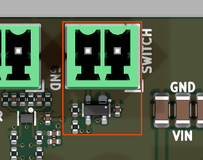

# limit_switch_debounced_input_vertical

<!-- Generated by orb-weaver-kicad-board-docs from board-manifest.yaml; do not edit. -->

Block `orb_weaver_private:limit_switch_debounced_input_vertical` placed in `/motor_encoder_switch` of **mouse-joystick-pcb**. Debounced limit-switch input with its own 2-position 3.5 mm VERTICAL, top-entry pluggable screw terminal — Phoenix MCV 1,5/2-G-3,5, OW-CONN-TBH-1X02-3P5-VERT, on the local orb_weaver_tht copy of the MCV footprint — plus a MAX6816 single switch debouncer and local Vcc decoupling.

|  |  |
| --- | --- |
| Lifecycle | routed |
| Family | none (a private block) |
| Placement | anchor (18, -36) mm, rotation 180°, front side |
| Sheet | `limit_switch_debounced_input_vertical.kicad_sch`; sheet pins: the board's own arrangement |
| Drawing | [mouse-joystick-pcb-motor_encoder_switch-limit_switch_debounced_input_vertical.svg](../schematic/mouse-joystick-pcb-motor_encoder_switch-limit_switch_debounced_input_vertical.svg) |

## On the Board

Block 3 of the [board view](../board-view.md): 9.4 × 13.4 mm on the top side, its centre 18.0 mm right of and 32.8 mm above the board centre (X right, Y up, as the enclosure tables); 5 footprints. The picture is the top render clipped around the block, the rectangle the extent of its footprints' courtyards.

## Description

Debounced limit-switch input with its own 2-position 3.5 mm VERTICAL, top-entry pluggable screw terminal — Phoenix MCV 1,5/2-G-3,5, OW-CONN-TBH-1X02-3P5-VERT, on the local orb_weaver_tht copy of the MCV footprint — plus a MAX6816 single switch debouncer and local Vcc decoupling. Four parts: nothing external belongs on the IN side, because the MAX6816 supplies its own IN pull-up and +/-15 kV ESD protection and needs no external pull-up, series resistor, or input capacitor — the fourth part is a 100 kohm pull-down on the OUTPUT, doing an unrelated job. Electrically identical to the horizontal limit_switch_debounced_input block, port for port and part for part including the pull-down: +3.3V_SW, GND, LIMIT_SW.
Connect a dry-contact mechanical switch across the terminal; pin 1 is GND, pin 2 is the switch node, and the contact is polarity-agnostic. OUT follows IN non-inverting after roughly 50 ms of debounce, so LIMIT_SW is ACTIVE LOW on switch closure and asserts ~50 ms late — bound homing approach velocity so that delay cannot overshoot the mechanical stop.
Supply +3.3V from the SWITCHED power domain on any board where LIMIT_SW drives a chip that can be powered down: if the debouncer stays alive while its consumer does not, OUT back-powers that chip through its input pin, by a route a GPIO bus switch cannot cover. On mouse-joystick-pcb that means +3V3_SW, and LIMIT_SW fans out to the TMC5130A REFL pin and to an always-on instrumentation buffer — it reaches no MCU GPIO in any revision, decided 2026-08-16, so nothing downstream defines this net either.
R33001, 100 kohm from LIMIT_SW to GND (OW-PASS-RC0402JR-07100KL, LCSC C106234), is what defines it while that domain is down, and it is REQUIRED, not optional: THE MAX6816 HAS NO Ioff. With Vcc at 0 V its push-pull OUT is undefined, and a board that taps LIMIT_SW for instrumentation must put the tap buffer on the ALWAYS-ON rail — a buffer on the switched rail cannot observe the domain it is powering down with — so without this resistor a live, non-Schmitt CMOS input sees a floating source every time the switched domain is cycled, which on that board is the normal reset path. IT BELONGS IN THE BLOCK, NOT AT BOARD LEVEL, and that does not contradict the usual rule: that rule exists because a net shared between two instances of one block gets its pull halved, and LIMIT_SW is point-to-point inside a single instance — place this block twice and you get two switches, two debouncers and two independent LIMIT_SW nets, each with its own pull-down. The same call is already made in quadrature_encoder_input_5v_sn74lvc2g17, whose R30005/R30006 cover Ioff high-Z on that block's outputs for exactly this reason; the case here is stronger, because the SN74LVC2G17 has Ioff and the MAX6816 does not.
100 kohm AND NOT 10 kohm: this net idles HIGH, since a normally-open contact plus the internal IN pull-up puts OUT high whenever the axis is away from the limit, so the pull-down conducts continuously in the normal state — 33 uA at 100 kohm against 330 uA at 10 kohm — and 100 kohm spends no meaningful VOH margin either.
KNOW THE POLARITY CONSEQUENCE BEFORE TRUSTING A CAPTURE: LIMIT_SW is active low, so this resistor makes an instrument tap read ASSERTED, limit reached, whenever the switched rail is off. Defined-but-untrue is the deliberate trade against floating, and the analysis layer must gate the channel on rail state. A pull-up is not an alternative — it would have to reference the switched rail, which is at 0 V exactly when it would be needed.
Bring REFL to a labelled test pad at board level so a jumper can force a closure during bring-up. Add no capacitor on IN — it fights the debounce and degrades the ESD rating. Keep the decoupling hard against Vcc.
ROUTING THE PULL-DOWN IS TIGHT, AND IT IS AT THE LIMIT: R33001 sits above the MAX6816 with its LIMIT_SW pad on the same side as the IC's OUT pin, so the two nets never need to cross — but they share a corridor bounded by the IN pad and sit on 0.5 mm centres. EVERY TRACK IN THIS BLOCK IS THEREFORE 0.3 mm, not the 0.4 mm it was authored at, which puts the LIMIT_SW-to-GND gap at exactly 0.200 mm against a 0.200 mm netclass rule and the GND-to-IN-pad gap at 0.225 mm: DRC-clean with ZERO MARGIN on the first of those. Do not widen either run without moving it first — 0.4 mm on these centres is a 0.100 mm gap, which sits exactly on the JLCPCB routine copper floor in .kicad_dru and errors under any 0.2 mm netclass. There is room to move: the LIMIT_SW column can go about 0.5 mm further from GND, straight up out of OUT. Re-run DRC after any change here, because design_block_tools.py check counts only unconnected items and is blind to a clearance error.
THIS BLOCK IS A FORK BY CHOICE, NOT BY GEOMETRY. Unlike usb2_vertical and pycontrol_behavior_port_rj45_boundary_vertical, whose land patterns are unrelated to their horizontal counterparts, this footprint is pad-identical to the horizontal MC 1,5/2-G-3,5: both are 1.8 x 3.6 mm pads on a 1.2 mm drill at 3.50 mm pitch, pin order ascending in +x. The copper is a drop-in; only the footprint ANCHOR moves, because the horizontal is centred on the pad array with pin 1 at (-1.75, 0) while the vertical puts pin 1 at the origin. Migrating an existing placement therefore means changing the part and then MOVING THE FOOTPRINT BY (-1.75, 0) so pad 1 returns to its old absolute position; skip that and the whole connector translates by 1.75 mm and drags every attached track with it. The two parts are genuinely interchangeable at the catalog level and belong to equiv_group conn-tbh-1x02-3p5, which docs/connector-orientation-plan.md specifies but which is not yet populated on any row — treat it as owed. Because the pads are identical, the two layouts stay transferable in either direction once the connector is shifted by (-1.75, 0).
What actually changes is the mechanical envelope, and it inverts. Relative to pad 1 the horizontal courtyard runs x -2.45 to +5.95, y -2.00 to +8.25; the vertical runs x -2.95 to +6.45, y -4.75 to +3.50. The outboard overhang collapses from 8.25 mm to 3.50 mm, so the terminal can move inboard and the board outline notes change — but the INBOARD KEEPOUT GROWS from 2.00 mm to 4.75 mm, so a swap in place can collide with whatever sits behind the connector even though no pad moved. DO NOT ROTATE 180 DEGREES to make the wire entry face outboard: pin order runs the same direction in both footprints, and rotating reverses it in board space, silently swapping GND and the switch node. The wire now leaves perpendicular to the board, so the enclosure in ../mouse-joysticks-mech needs an aperture above the terminal plus clearance for the screw head, the mating plug, and the wire loop.
Project-local pending bench verification; promotable once a second board uses it.

## Ports

The brief's shape, edge, class and meaning for each port, then what the board wires it to.

| Port | Shape | Edge | Class | Wired to | Board net | Board class | GPIO | Meaning | On this board |
| --- | --- | --- | --- | --- | --- | --- | --- | --- | --- |
| `+3.3V_SW` | passive | west | Default | `+3.3V` | `/+3.3V_SW` | PWR_3V3 |  | Debouncer supply, 2.7 to 5.5 V; bind it to the switched domain of whatever LIMIT_SW drives, so the debouncer cannot back-power a powered-down consumer through OUT. |  |
| `GND` | passive | west | PWR_RETURN_LOCAL | `GND` | `/GND` | PWR_RETURN_LOCAL |  | Return; terminal pin 1 (the switch's other side), the Vcc bypass and the output pull-down. |  |
| `LIMIT_SW` | output | east | Default | `LIMIT_SW` | `/motor_encoder_switch/LIMIT_SW` | Default |  | Debounced switch state, active low on contact closure and about 50 ms late; push-pull at Vcc levels while powered, held low by R33001 when +3.3V_SW is off. |  |
| `LIMIT_SW_INST` | output | east | INSTRUMENT | `LIMIT_SW_INST` | `/LIMIT_SW_INST` | INSTRUMENT |  | Instrument tap of LIMIT_SW through R33002 (1 k), INSTRUMENT class; reads asserted while the switched rail is off. |  |

## Parts

As placed on the board's sheet; 5 of 5 paired with the brief's references by symbol identity, the rest given the brief's role where the internal part has one, else the catalog's role slug; the placement is the `Placement` field of the board's symbol, else of the library's (D38).

| Reference | Brief | Part | Value | Role | Placement |  |
| --- | --- | --- | --- | --- | --- | --- |
| `C1601` | `C33001` | `OW-CAP-100N-0402-X5R-16V` | 100nF | Vcc bypass for U33001 | beside U1601.4 (Vcc), on +3.3V_SW |  |
| `J1601` | `J33001` | `OW-CONN-TBH-1X02-3P5-VERT` | TBH-1x02-3.5mm | Vertical switch terminal, pin 1 GND, pin 2 IN |  |  |
| `R1601` | `R33001` | `OW-PASS-RC0402JR-07100KL` | 100k | Output pull-down for the unpowered state | beside U1601.3 (OUT), on LIMIT_SW |  |
| `R1602` | `R33002` | `OW-PASS-RC0402FR-071KL` | 1k | Instrument tap series resistor |  |  |
| `U1601` | `U33001` | `OW-MISC-MAX6816EUS-T` | MAX6816EUS+T | Switch debouncer |  |  |

## Operating Notes

- Signal path: J33001 pin 2 -> IN -> U33001 IN (pin 2) -> OUT (pin 3) -> LIMIT_SW, tapped through R33002 to LIMIT_SW_INST; J33001 pin 1 is GND. A closed contact pulls IN low; OUT follows IN non-inverting after the debounce (20 to 80 ms, 50 ms typical), so LIMIT_SW is active low and asserts late: bound the homing approach velocity.
- IN is complete inside U33001: internal pull-up 63 k typical, -25 to +25 V range, +/-15 kV air-gap ESD. No external pull-up, series resistor or capacitor on IN; a capacitor fights the debounce and degrades the ESD rating.
- Supply 2.7 to 5.5 V at 6 uA typical (UVLO 1.9 to 2.6 V). R33001 (100 k) defines LIMIT_SW low while +3.3V_SW is off, since the MAX6816 has no Ioff; the net idles high with a normally-open contact (about 33 uA at 3.3 V), so a capture on LIMIT_SW_INST reads asserted whenever the switched rail is off.
- Same circuit as limit_switch_debounced_input plus the tap. J33001 (Phoenix MCV 1,5/2-G-3,5) is pad-identical to the horizontal MC 1,5 but anchored on pin 1, with a 4.75 mm inboard courtyard and the wire leaving perpendicular to the board. Never rotate it 180 degrees to face outboard: that swaps GND and the switch node in board space.

## Placement and Routing

### Switch terminal and debouncer

`J33001`, `U33001`, `C33001`, `R33001`

J33001 brings the dry contact onto IN (pin 2) and GND (pin 1); U33001 debounces IN and drives LIMIT_SW from its push-pull OUT. C33001 (100 nF) bypasses Vcc (pin 4) to GND (pin 1).

- Place: Keep U33001 next to J33001 so IN stays short; nothing else connects to IN. Leave the 4.75 mm inboard keepout of the vertical terminal free, and give the enclosure an aperture above it for the plug, the screw head and the wire loop.
- Place: Place C33001 hard against pin 4 with a short return to pin 1.
- Route: The LIMIT_SW and GND runs share the corridor bounded by the IN pad on 0.5 mm centres: every track in the block is 0.3 mm, which leaves the LIMIT_SW-to-GND gap at exactly the 0.200 mm netclass rule. Move a run before widening it and re-run DRC after any change here.
- Route: +3.3V_SW has no reference-project class here (Default); the placing board classes the switched rail.

### Output pull-down and instrument tap

`R33002`

R33001 (100 k) holds LIMIT_SW low while the debouncer is unpowered; R33002 (1 k) is the series tap from LIMIT_SW to LIMIT_SW_INST.

- Place: R33001 sits above U33001 with its LIMIT_SW pad on the OUT side, so LIMIT_SW and GND never need to cross; R33002 goes where LIMIT_SW leaves toward the instrument port.
- Route: LIMIT_SW and LIMIT_SW_INST leave through vias (port copper); LIMIT_SW_INST carries the INSTRUMENT class.

## Library Identity

|  |  |
| --- | --- |
| Block | `orb_weaver_private:limit_switch_debounced_input_vertical` |
| Resolution | the placed id is in the library |
| Brief | `design_blocks/orb_weaver_private.kicad_blocks/limit_switch_debounced_input_vertical.kicad_block/limit_switch_debounced_input_vertical.brief.yaml`, the block's brief |
| Published sheet | `adab5cea95990acf` |
| Published PCB | `c0ccc0c8ef00c177` |
| Source lock | symbol snapshot `bdd920b7bf67c3bc`, published 2026-10-14 |
| Placed sheet | `45bbee1820863da4`: differs from the library's sheet; parts: the brief’s 5 by internal part; ports: the brief's |
| Netlist check | not run (`--brief-check`, kicad-cli) |

