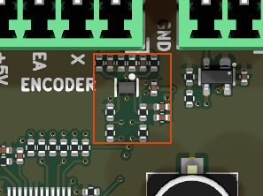

# quadrature_encoder_input_5v_sn74lvc2g17

<!-- Generated by orb-weaver-kicad-board-docs from board-manifest.yaml; do not edit. -->

Block `orb_weaver_private:quadrature_encoder_input_5v_sn74lvc2g17` placed in `/motor_encoder_switch` of **mouse-joystick-pcb**. Single-ended 5 V quadrature encoder input: per-channel series/RC conditioning plus an SN74LVC2G17 dual Schmitt-trigger buffer that translates an encoder's 5 V push-pull A/B outputs into clean 3.3 V logic.

|  |  |
| --- | --- |
| Lifecycle | routed |
| Family | none (a private block) |
| Placement | anchor (9, -28) mm, rotation 270°, front side |
| Sheet | `quadrature_encoder_input_5v_sn74lvc2g17.kicad_sch`; sheet pins: the board's own arrangement |
| Drawing | [mouse-joystick-pcb-motor_encoder_switch-quadrature_encoder_input_5v_sn74lvc2g17.svg](../schematic/mouse-joystick-pcb-motor_encoder_switch-quadrature_encoder_input_5v_sn74lvc2g17.svg) |

## On the Board

Block 2 of the [board view](../board-view.md): 7.1 × 8.3 mm on the top side, its centre 9.6 mm right of and 27.0 mm above the board centre (X right, Y up, as the enclosure tables); 14 footprints. The picture is the top render clipped around the block, the rectangle the extent of its footprints' courtyards.

## Description

Single-ended 5 V quadrature encoder input: per-channel series/RC conditioning plus an SN74LVC2G17 dual Schmitt-trigger buffer that translates an encoder's 5 V push-pull A/B outputs into clean 3.3 V logic. The connector deliberately lives outside the block, the same way differential_encoder_receiver is built, so one block serves screw-terminal, IDC, JST or Molex harnesses and the parent picks the housing to suit the machine. Bring the raw encoder channels in on EA and EB and take conditioned logic out on ENCA and ENCB; ENCA_INST and ENCB_INST are their instrument taps. Use this for TTL/push-pull encoders; use differential_encoder_receiver instead for RS-422 A+/A-/B+/B- encoders.
The Schmitt input is the point of the block: a typical 5 V encoder rises in about 100 ns over a 4 V swing, roughly 25 ns/V, which violates the 8 ns/V input transition rate limit of an ordinary LVC buffer and would let noise on the slow edge double-clock the quadrature counter into permanent, silent position error. The 2G17 has no such limit and 0.4 V minimum hysteresis at 3 V, and it closes against the encoder's guaranteed worst case with 400 mV to spare on both rails: VOH >= 2.4 V versus VT+ <= 2.0 V, VOL <= 0.4 V versus VT- >= 0.8 V. Do not substitute a resistive divider into a 3.3 V input: dividing the encoder's guaranteed 2.4 V VOH by 0.66 gives 1.58 V, below the 2.31 V VINHI of a 3.3 V VCC_IO TMC5130A input, and loading the output makes it worse.
The 4.7 kohm series resistors R30003/R30004 are the protection element and the reason the block tolerates a field-wired harness: they bound a short to a 36 V rail to about 7 mA, so a miswire kills a 0.19 USD buffer instead of the motor driver. The 100 kohm resistors R30001/R30002 sit on the harness side of those series resistors rather than after them, so they define the buffer input when the harness is unplugged without forming a divider that would eat VIH margin; R30005/R30006 on the outputs cover Ioff high-Z when the buffer's supply is down, so an always-on downstream instrumentation buffer never sees a floating input.
The VENC and +3.3V ports are intentionally generic so a parent can bind them to whatever it calls its rails, but the electrical requirement is not generic: on any board where the encoder's consumer can be powered down, bind both to that board's SWITCHED domain, so the encoder, this buffer and the consumer rise and fall together. Rail sequencing between the two is a non-issue: inputs are rated 0 to 5.5 V at any valid VCC with 6.5 V absolute maximum and no clamp diode to VCC, and Ioff disables the outputs when the part is unpowered.
Size C30002/C30003 for a corner >= 10x CPR*RPM/60; 27 pF gives 1.25 MHz, 470 pF gives 72 kHz for a slow axis that needs more rejection. This block covers A/B only. If your encoder has an index channel, add a second SN74LVC2G17 with its spare input tied to GND; if it does not, the consuming controller's index pin still needs an explicit tie: the TMC5130A datasheet requires ENCN be pulled to GND or VCC_IO when unused.
For layout: C30001 and C30004 decouple the encoder supply VENC and want to sit as close to the parent's encoder connector as placement allows; R30003 and R30004 at the block's input edge, C30002 at U30001 pin 1 and C30003 at pin 3 with short returns; C30005 hard against U30001 pin 5; route the A/B pair with a ground reference between them and well away from motor bridge outputs.

## Ports

The brief's shape, edge, class and meaning for each port, then what the board wires it to.

| Port | Shape | Edge | Class | Wired to | Board net | Board class | GPIO | Meaning | On this board |
| --- | --- | --- | --- | --- | --- | --- | --- | --- | --- |
| `+3.3V` | passive | west | PWR_3V3_LOCAL | `+3.3V` | `/+3.3V_SW` | PWR_3V3 |  | Buffer supply, U30001 VCC (pin 5); 3.3 V logic domain of the outputs; bypassed by C30005. |  |
| `EA` | input | west | Default | `ENCA_5V` | `/motor_encoder_switch/ENCA_5V` | Default |  | Encoder channel A, raw 5 V push-pull from the harness; R30001 to GND, R30003 in series. |  |
| `EB` | input | west | Default | `ENCB_5V` | `/motor_encoder_switch/ENCB_5V` | Default |  | Encoder channel B, raw 5 V push-pull from the harness; R30002 to GND, R30004 in series. |  |
| `ENCA` | output | east | Default | `ENCA` | `/motor_encoder_switch/ENCA` | Default |  | Channel A as 3.3 V logic from U30001 1Y (pin 6); R30005 holds it low when unpowered. |  |
| `ENCA_INST` | output | east | INSTRUMENT | `ENCA_INST` | `/ENCA_INST` | INSTRUMENT |  | Instrument tap of ENCA through R30007 (100 ohm), INSTRUMENT class. |  |
| `ENCB` | output | east | Default | `ENCB` | `/motor_encoder_switch/ENCB` | Default |  | Channel B as 3.3 V logic from U30001 2Y (pin 4); R30006 holds it low when unpowered. |  |
| `ENCB_INST` | output | east | INSTRUMENT | `ENCB_INST` | `/ENCB_INST` | INSTRUMENT |  | Instrument tap of ENCB through R30008 (100 ohm), INSTRUMENT class. |  |
| `GND` | passive | west | PWR_RETURN_LOCAL | `GND` | `/GND` | PWR_RETURN_LOCAL |  | Return for the buffer, both RC shunts, all pull-downs and the supply bypass. |  |
| `VENC` | passive | west | Default | `+5V` | `/+5V_SW` | PWR_5V |  | Encoder supply passed through to the harness; bypassed here by C30001 and C30004. |  |

## Parts

As placed on the board's sheet; 14 of 14 paired with the brief's references by symbol identity, the rest given the brief's role where the internal part has one, else the catalog's role slug; the placement is the `Placement` field of the board's symbol, else of the library's (D38).

| Reference | Brief | Part | Value | Role | Placement |  |
| --- | --- | --- | --- | --- | --- | --- |
| `C1501` | `C30001` | `OW-CAP-4U7-0402-X5R-16V` | 4.7uF | VENC bulk bypass, 4.7 uF |  |  |
| `C1502` | `C30002` | `OW-CAP-470P-0402-C0G-100V` | 470pF | RC filter shunt at Schmitt input 1A, pin 1 | beside U1501A.1 (1A), on EA_FILT |  |
| `C1503` | `C30003` | `OW-CAP-470P-0402-C0G-100V` | 470pF | RC filter shunt at Schmitt input 2A, pin 3 | beside U1501B.3 (2A), on EB_FILT |  |
| `C1504` | `C30004` | `OW-CAP-100N-0402-X5R-16V` | 100nF | VENC bypass, 100 nF |  |  |
| `C1505` | `C30005` | `OW-CAP-100N-0402-X5R-16V` | 100nF | VCC pin 5 bypass, 100 nF | beside U1501C.5 (VCC), on +3.3V |  |
| `R1501` | `R30001` | `OW-PASS-RC0402JR-07100KL` | 100k | Pull-down, harness side, 100 k |  |  |
| `R1502` | `R30002` | `OW-PASS-RC0402JR-07100KL` | 100k | Pull-down, harness side, 100 k |  |  |
| `R1503` | `R30003` | `OW-RES-4K7-0402` | 4.7k | Series limit, RC 72 kHz with C30002 |  |  |
| `R1504` | `R30004` | `OW-RES-4K7-0402` | 4.7k | Series limit, RC 72 kHz with C30003 |  |  |
| `R1505` | `R30005` | `OW-PASS-RC0402JR-07100KL` | 100k | Pull-down, buffer output, 100 k | beside U1501A.6 (1Y), on ENCA |  |
| `R1506` | `R30006` | `OW-PASS-RC0402JR-07100KL` | 100k | Pull-down, buffer output, 100 k | beside U1501B.4 (2Y), on ENCB |  |
| `R1507` | `R30007` | `OW-PASS-0402WGF1000TCE` | 100 | Instrument tap, 100 R, to ENCA_INST |  |  |
| `R1508` | `R30008` | `OW-PASS-0402WGF1000TCE` | 100 | Instrument tap, 100 R, to ENCB_INST |  |  |
| `U1501` | `U30001` | `OW-MISC-SN74LVC2G17DRYR` | SN74LVC2G17DRYR | Dual Schmitt buffer, 5 V in to 3.3 V out |  |  |

## Operating Notes

- Signal path per channel: EA -> R30003 (4.7 k) -> EA_FILT -> U30001 1A (pin 1) -> 1Y (pin 6) = ENCA; EB -> R30004 -> EB_FILT -> 2A (pin 3) -> 2Y (pin 4) = ENCB. A/B only: an index channel needs a second buffer.
- Each series resistor with its 470 pF shunt (C30002, C30003) is a low-pass of tau = 4.7 k x 470 pF = 2.2 us, corner about 72 kHz; it removes harness noise and slows the edge into a Schmitt input, which has no slew-rate limit.
- U30001 (SN74LVC2G17, 1.65 to 5.5 V supply) at 3.3 V: VT+ 1.3 to 2.0 V, VT- 0.8 to 1.3 V (facts at 3 V), 0.4 V minimum hysteresis; inputs are 5.5 V tolerant with no clamp to VCC, so the 5 V encoder drives them directly and Ioff (10 uA max) keeps the outputs high-impedance when +3.3V is down.
- R30003 and R30004 are also the protection: a harness short to a 36 V rail is bounded to about 7.7 mA. R30001 and R30002 (100 k) define the inputs when the harness is unplugged; R30005 and R30006 (100 k) hold ENCA and ENCB low when the buffer is unpowered, so a downstream instrument never sees a floating input.
- R30007 and R30008 (100 ohm) are the instrument taps to ENCA_INST and ENCB_INST (convention 14: the block owns its outputs). C30001 (4.7 uF) and C30004 (100 nF) bypass the encoder supply VENC near the harness; C30005 (100 nF) bypasses VCC at pin 5.
- The placing board provides VENC and +3.3V from the same switched domain as the encoder consumer, the GND return and the harness connector; it decides ENCN handling when no index channel exists.

## Placement and Routing

### Channel A input conditioning

`R30003`, `R30001`

EA passes through R30003 to EA_FILT; R30001 pulls the harness side to GND, C30002 shunts the filtered node to GND (72 kHz corner with R30003).

- Place: R30003 at the block's input edge near the harness connector; C30002 at U30001 pin 1 with a short return.
- Route: Keep EA and EB together with a ground reference between them and away from motor bridge outputs; EA_FILT is a short local node.

### Channel B input conditioning

`R30004`, `R30002`

EB passes through R30004 to EB_FILT; R30002 pulls the harness side to GND, C30003 shunts the filtered node to GND.

- Place: R30004 at the input edge beside R30003; C30003 at U30001 pin 3 with a short return.
- Route: Same as channel A; match the two channels' routing so their delays stay equal.

### Schmitt buffer and VCC bypass

`U30001`, `C30005`, `R30005`, `R30006`, `C30002`, `C30003`

U30001 squares and translates both channels to 3.3 V logic; C30005 bypasses VCC (pin 5) to GND (pin 2).

- Place: Place C30005 hard against U30001 pin 5 with its GND end at pin 2.
- Route: Short VCC and GND stubs; the outputs 1Y and 2Y leave toward ENCA and ENCB.

### Output pull-downs and instrument taps

`R30007`, `R30008`

R30005 and R30006 hold ENCA and ENCB low when the buffer is unpowered; R30007 and R30008 tap them to ENCA_INST and ENCB_INST.

- Place: Place the pull-downs near the buffer outputs and the taps where the instrument nets leave the block.
- Route: ENCA_INST and ENCB_INST carry the INSTRUMENT class; keep them off the ENCA and ENCB paths to the controller.

### Encoder supply bypass

`C30001`, `C30004`

C30001 (4.7 uF) and C30004 (100 nF) bypass VENC, the encoder supply the board passes to the harness.

- Place: Place both where VENC leaves toward the harness connector, C30004 closest to it.
- Route: VENC is on the Default class here; the board classes it with the encoder's supply.

## Library Identity

|  |  |
| --- | --- |
| Block | `orb_weaver_private:quadrature_encoder_input_5v_sn74lvc2g17` |
| Resolution | the placed id is in the library |
| Brief | `design_blocks/orb_weaver_private.kicad_blocks/quadrature_encoder_input_5v_sn74lvc2g17.kicad_block/quadrature_encoder_input_5v_sn74lvc2g17.brief.yaml`, the block's brief |
| Published sheet | `9ea7e28da205e642` |
| Published PCB | `729da4652e0af43a` |
| Source lock | symbol snapshot `7b3aea27bea7d460`, published 2026-10-14 |
| Placed sheet | `7d1fcb330836a385`: differs from the library's sheet; parts: the brief’s 14 by internal part; ports: the brief's |
| Netlist check | not run (`--brief-check`, kicad-cli) |

