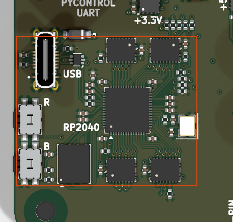

# rp2040_with_gpio_isolation_sn74cb3q3245

<!-- Generated by orb-weaver-kicad-board-docs from board-manifest.yaml; do not edit. -->

Block `orb_weaver_private:rp2040_with_gpio_isolation_sn74cb3q3245` placed in `/mcu` of **mouse-joystick-pcb**. RP2040 controller core and its GPIO isolation in one block: the full rp2040 core - W25Q128JVPIQ QSPI flash, 12 MHz ABM8 crystal, decoupling, BOOTSEL and RUN switches - plus four SN74CB3Q3245RGYR 8-channel bidirectional FET bus switches, with all 29 MCU-to-switch connections made inside the block so that routing is placed once instead of re-drawn per board.

|  |  |
| --- | --- |
| Lifecycle | routed |
| Family | none (a private block) |
| Placement | anchor (-32, 19) mm, rotation 90°, front side |
| Sheet | `rp2040_with_gpio_isolation_sn74cb3q3245.kicad_sch`; sheet pins: the board's own arrangement |
| Drawing | [mouse-joystick-pcb-mcu-rp2040_with_gpio_isolation_sn74cb3q3245.svg](../schematic/mouse-joystick-pcb-mcu-rp2040_with_gpio_isolation_sn74cb3q3245.svg) |

## On the Board

Block 9 of the [board view](../board-view.md): 28.8 × 23.7 mm on the top side, its centre 35.1 mm left of and 19.1 mm below the board centre (X right, Y up, as the enclosure tables); 35 footprints. The picture is the top render clipped around the block, the rectangle the extent of its footprints' courtyards.

## Description

RP2040 controller core and its GPIO isolation in one block: the full rp2040 core (W25Q128JVPIQ QSPI flash, 12 MHz ABM8 crystal, decoupling, BOOTSEL and RUN switches) plus four SN74CB3Q3245RGYR 8-channel bidirectional FET bus switches, with all 29 MCU-to-switch connections made inside the block so that routing is placed once instead of re-drawn per board. Derived from rp2040, which remains canonical for an MCU with no isolation and is the upstream for the core half: fix core circuitry there first, then refresh here. The switch half has no upstream; fix it here. This block replaces the retired isolation-only companion rp2040_gpio_isolation_sn74cb3q3245 outright and is the only isolated form. Core parts are positionally identical to rp2040. DO NOT place this block alongside rp2040: it already contains that core. Designators are the 40xxx band.
Decoupling: C40003 (1 uF) is the +3.3V bulk at VREG_IN and seven 100 nF serve the nine +3.3V supply pins: C40005 at IOVDD 1, C40014 at IOVDD 10, C40009 at IOVDD 22, C40007 at IOVDD 33, and C40010, C40011 and C40013 at the corner of IOVDD 42, ADC_AVDD 43, VREG_IN 44, USB_VDD 48 and IOVDD 49, where the routed PCB fixes the pairing. C40012 bypasses the flash VCC (U40002 pin 8); C40016 to C40019 bypass VCC pin 20 of U40003 to U40006 in turn. The regulator's +1.1V has C40006 at DVDD 23, C40008 at VREG_VOUT 45 and C40004 (1 uF) beside DVDD 50.
1. THE INTERFACE IS 64 PORTS AND GPIO9 IS NOT ONE OF THEM: 29 raw MCU ports GPIO0-GPIO8 and GPIO10-GPIO29, 29 switched ports ISO0-ISO8 and ISO10-ISO29, USB_D+, USB_D-, +3.3V, GND, and the enable ~{BUS_SW_EN} with its instrument tap ~{BUS_SW_EN}_INST, both for observation only. GPIO9 is spent on the bus-switch enable and has no GPIO or ISO port; there is no ISO9 and no separate ~{OE} port. Any board placing this block gives up GPIO9 and inherits ~{BUS_SW_EN} as a firmware constant. tmc51x0-driver-dev-pcb puts the same signal on GPIO19 and does NOT use this block; do not align them.
2. GPIOn AND ISOn ARE THE SAME NODE WHENEVER THE BUS IS ENABLED. Per index they are an either/or, not a fan-out. Wiring both shorts whatever sits on the always-on side to whatever sits on the switched side the instant firmware pulls ~{BUS_SW_EN} low, and neither ERC nor DRC can see it. The board chooses per signal, and the rule is the powered domain of the far end: a GPIO goes through the switch if and only if its far end sits on a switched rail. See mouse-joystick-pcb docs/interface-map.md, The Rule - Follow The Far End's Power Domain.
3. THE ISO SIDE IS A BARE PASS GATE: no level shift, no buffer, no protection, no direction. Switch I/O is rated 0-5.5 V but the other end of every channel is an RP2040 pad limited to IOVDD+0.3 V, so a 5 V pull-up or a 5 V driver on an ISO pin damages the MCU, not the switch. Do not give ISO ports a direction shape: the gate is symmetric and they are passive by construction. Pull-ups and pull-downs on the switched side must reference the SWITCHED rail, never +3.3V, or they back-power the dead domain through the far chip's input clamps inside a block where the bus switch cannot see it.
4. THE ENABLE IS THE MCU'S, ACTIVE LOW, AND DISABLED BY DEFAULT: GPIO9 drives ~{BUS_SW_EN} to all four pin 19 inputs, with R40007 7.87 k to +3.3V so the bus is isolated at power-on until firmware asserts it. The enable cannot sit behind the switch it enables, and an MCU must be able to connect a bus that is currently disconnected, so the board never sources it: ~{BUS_SW_EN} leaves the block only to be observed, and ~{BUS_SW_EN}_INST through R40004 (1 k) is its instrument tap. NEVER drive it from the board; a second driver fights the MCU and the pull-up is the only thing defining the reset state. Sequencing is board policy and firmware must follow it: isolate first, then drop the rail; raise the rail, confirm it, then connect last. t_en is 14 ns max and t_dis 13 ns max at 3.3 V, so the disconnect is deterministic and instantaneous relative to any rail.
5. SUPPLY IS THE ALWAYS-ON 3.3 V RAIL, DELIBERATELY, AND THERE IS NO Ioff SECOND LINE OF DEFENCE. One +3.3V port feeds the MCU, all four V_CC pins and the pull-up. Powering the switches from the switched domain would give free isolation through Ioff at V_CC=0 and cost no GPIO, and is REJECTED: it hands sequencing to a rail ramp, removes the ability to isolate before powering down, and leaves the always-on MCU driving an enable input on an unpowered part; Ioff is specified for the data terminals (V_CC=0, 0 to 5.5 V, 1 uA max) with no control-input condition stated, and V_IH is characterized only over V_CC 2.3-3.6 V. Isolation therefore rests entirely on the MCU holding ~{BUS_SW_EN} high, which R40007 makes the reset default. This contradicts the catalog note on OW-MISC-SN74CB3Q3245RGYR, which recommends switched-domain power; the block and the boards win, see kicad-libs docs/rp2040-gpio-isolation-design-block-plan.md.
6. IT COSTS 4 mA JUST BY EXISTING: I_CC is 1 mA typ and 2 mA max per package with the switch ON OR OFF, because the charge pump runs regardless, so four packages draw about 4 mA typ and 8 mA max continuously from the always-on rail even with every channel isolated. That is the price of 1:1 coverage and it is accepted.
7. ONE CHANNEL PER GPIO, AND THREE SPARES. Pairing on the RGY-20 package is A_n = pin (n+1) and B_n = pin (19-n); A IS THE SWITCHED SIDE AND B IS THE MCU SIDE. U40003 carries GPIO0-GPIO7 to ISO0-ISO7, U40004 GPIO8 and GPIO10-GPIO15 to ISO8 and ISO10-ISO15, U40005 GPIO16-GPIO23 to ISO16-ISO23, U40006 GPIO24-GPIO29 to ISO24-ISO29. The three unused channels are U40004 channel 2, freed by the enable, and U40006 channels 7 and 8. Treatment for every spare is the same and is not arbitrary: MCU-side B pin to GND, A pin left open, so no node floats on the always-on rail and no switched-side pin is a hidden hard ground.
8. THE BOARD OWES NO-CONNECTS AND ITS OWN BIAS. Most ISO and raw ports are unused on any given board; flag them no-connect rather than leaving them dangling. Unused channels need nothing else: the pass gate has no internal buffer, so an open data pin is not a floating CMOS input. Bus terminations, input bias and instrument taps are board-level or belong to the far-end block, never here. USB_D+ and USB_D- leave OUTSIDE the 27 ohm series resistors R40001 and R40002; do not add more series resistance at the board.
9. CORE GOTCHAS CARRIED FROM rp2040 (full text in that block's description): SWD IS NOT EXPOSED, pins 24 and 25 are deliberately open and no debug-connector footprint exists in the libraries, so this block offers no debug header. Place SW40002 (RUN) physically adjacent to SW40001 (BOOTSEL) on the same board edge or the one-handed hold-BOOTSEL-tap-RUN recovery gesture becomes a two-handed operation on an installed rig. C40015 is the exception to that adjacency: it decouples RUN and belongs hard against pin 26 with a short return. RUN has no external pull-up and needs none (the internal 50-80 k is the only one) and needs neither the 1 k series nor the 10 k pull-up that belong to BOOTSEL's QSPI_SS. A RUN reset does NOT reset U40002, so a warm reset that hangs where a power cycle works is the flash. RUN also releases every GPIO to high-Z, so the placing board must ensure each domain it controls defaults to safe on MCU reset.
10. TWO INSTANCES NEED SEPARATE SHEETS or the internal nets (RUN, ~{USB_BOOT}, QSPI_SS, XIN, XOUT, XOUTB, +1.1V, D+ and D-) silently merge between copies.

## Ports

The brief's shape, edge, class and meaning for each port, then what the board wires it to.

| Port | Shape | Edge | Class | Wired to | Board net | Board class | GPIO | Meaning | On this board |
| --- | --- | --- | --- | --- | --- | --- | --- | --- | --- |
| `+3.3V` | passive | west | PWR_3V3_LOCAL | `+3.3V_MCU` | `/+3.3V_MCU` | PWR_3V3 |  | Always-on 3.3 V for the MCU, flash, four switches and pull-ups. |  |
| `GND` | passive | west | PWR_RETURN_LOCAL | `GND` | `/GND` | PWR_RETURN_LOCAL |  | Common return: core, flash, switches (GND, EPAD), crystal, switch frames. |  |
| `GPIO0` | bidirectional | west | Default | `PYC_UART_TX` | `/PYC_UART_TX` | MCU_FINE | `GP0` | Raw MCU GPIO0, 3.3 V; one node with ISO0 via U40003 B1 (pin 18) when enabled. | UART TX to pyControl (`UART0 TX`); out as the MCU sees it |
| `GPIO1` | bidirectional | west | Default | `PYC_UART_RX` | `/PYC_UART_RX` | MCU_FINE | `GP1` | Raw MCU GPIO1, 3.3 V; one node with ISO1 via U40003 B2 (pin 17) when enabled. | UART RX from pyControl (`UART0 RX`); in as the MCU sees it |
| `GPIO2` | bidirectional | west | Default | open: no-connect flag |  |  |  | Raw MCU GPIO2, 3.3 V; one node with ISO2 via U40003 B3 (pin 16) when enabled. |  |
| `GPIO3` | bidirectional | west | Default | open: no-connect flag |  |  |  | Raw MCU GPIO3, 3.3 V; one node with ISO3 via U40003 B4 (pin 15) when enabled. |  |
| `GPIO4` | bidirectional | west | Default | open: no-connect flag |  |  |  | Raw MCU GPIO4, 3.3 V; one node with ISO4 via U40003 B5 (pin 14) when enabled. |  |
| `GPIO5` | bidirectional | west | Default | open: no-connect flag |  |  |  | Raw MCU GPIO5, 3.3 V; one node with ISO5 via U40003 B6 (pin 13) when enabled. |  |
| `GPIO6` | bidirectional | west | Default | open: no-connect flag |  |  |  | Raw MCU GPIO6, 3.3 V; one node with ISO6 via U40003 B7 (pin 12) when enabled. |  |
| `GPIO7` | bidirectional | west | Default | open: no-connect flag |  |  |  | Raw MCU GPIO7, 3.3 V; one node with ISO7 via U40003 B8 (pin 11) when enabled. |  |
| `GPIO8` | bidirectional | west | Default | open: no-connect flag |  |  |  | Raw MCU GPIO8, 3.3 V; one node with ISO8 via U40004 B1 (pin 18) when enabled. |  |
| `GPIO10` | bidirectional | west | Default | open: no-connect flag |  |  |  | Raw MCU GPIO10, 3.3 V; one node with ISO10 via U40004 B3 (pin 16) when enabled. |  |
| `GPIO11` | bidirectional | west | Default | open: no-connect flag |  |  |  | Raw MCU GPIO11, 3.3 V; one node with ISO11 via U40004 B4 (pin 15) when enabled. |  |
| `GPIO12` | bidirectional | west | Default | open: no-connect flag |  |  |  | Raw MCU GPIO12, 3.3 V; one node with ISO12 via U40004 B5 (pin 14) when enabled. |  |
| `GPIO13` | bidirectional | west | Default | open: no-connect flag |  |  |  | Raw MCU GPIO13, 3.3 V; one node with ISO13 via U40004 B6 (pin 13) when enabled. |  |
| `GPIO14` | bidirectional | west | Default | `HV_DIAG_EN` | `/HV_DIAG_EN` | MCU_FINE | `GP14` | Raw MCU GPIO14, 3.3 V; one node with ISO14 via U40004 B7 (pin 12) when enabled. | 36 V switch diagnostics enable⁵; out as the MCU sees it |
| `GPIO15` | bidirectional | west | Default | open: no-connect flag |  |  |  | Raw MCU GPIO15, 3.3 V; one node with ISO15 via U40004 B8 (pin 11) when enabled. |  |
| `GPIO16` | bidirectional | west | Default | `DAC_SDA_BYP` | `/mcu/DAC_SDA_BYP` | MCU_FINE |  | Raw MCU GPIO16, 3.3 V; one node with ISO16 via U40005 B1 (pin 18) when enabled. |  |
| `GPIO17` | bidirectional | west | Default | `DAC_SCL_BYP` | `/mcu/DAC_SCL_BYP` | MCU_FINE |  | Raw MCU GPIO17, 3.3 V; one node with ISO17 via U40005 B2 (pin 17) when enabled. |  |
| `GPIO18` | bidirectional | west | Default | open: no-connect flag |  |  |  | Raw MCU GPIO18, 3.3 V; one node with ISO18 via U40005 B3 (pin 16) when enabled. |  |
| `GPIO19` | bidirectional | west | Default | `HV_EN` | `/HV_EN` | MCU_FINE | `GP19` | Raw MCU GPIO19, 3.3 V; one node with ISO19 via U40005 B4 (pin 15) when enabled. | 36 V input switch enable; out as the MCU sees it |
| `GPIO20` | bidirectional | west | Default | open: no-connect flag |  |  |  | Raw MCU GPIO20, 3.3 V; one node with ISO20 via U40005 B5 (pin 14) when enabled. |  |
| `GPIO21` | bidirectional | west | Default | `FW_TRIG1` | `/FW_TRIG1` | MCU_FINE | `GP21` | Raw MCU GPIO21, 3.3 V; one node with ISO21 via U40005 B6 (pin 13) when enabled. | Firmware timing marker; out as the MCU sees it |
| `GPIO22` | bidirectional | west | Default | open: no-connect flag |  |  |  | Raw MCU GPIO22, 3.3 V; one node with ISO22 via U40005 B7 (pin 12) when enabled. |  |
| `GPIO23` | bidirectional | west | Default | `~{HV_FAULT}` | `/~{HV_FAULT}` | MCU_FINE | `GP23` | Raw MCU GPIO23, 3.3 V; one node with ISO23 via U40005 B8 (pin 11) when enabled. | 36 V switch fault, open-drain, pull-up 3.3 V¹¹; in as the MCU sees it |
| `GPIO24` | bidirectional | west | Default | `HV_LATCH` | `/HV_LATCH` | MCU_FINE | `GP24` | Raw MCU GPIO24, 3.3 V; one node with ISO24 via U40006 B1 (pin 18) when enabled. | 36 V switch latch-off select¹⁰; out as the MCU sees it |
| `GPIO25` | bidirectional | west | Default | `FW_TRIG0` | `/FW_TRIG0` | MCU_FINE | `GP25` | Raw MCU GPIO25, 3.3 V; one node with ISO25 via U40006 B2 (pin 17) when enabled. | Firmware timing marker; out as the MCU sees it |
| `GPIO26` | passive | west | Default | `SW_RAIL_SENSE_DIV_2` | `/mcu/SW_RAIL_SENSE_DIV_2` | MCU_FINE | `GP26` | Raw MCU GPIO26/ADC0, 3.3 V; one node with ISO26 via U40006 B3 (pin 16) when enabled. | +3.3V_SW presence and level, divided by 2 inside mcu (R408/R409); in as the MCU sees it |
| `GPIO27` | passive | west | Default | `BRAKE_ISENSE` | `/BRAKE_ISENSE` | MCU_FINE | `GP27` | Raw MCU GPIO27/ADC1, 3.3 V; one node with ISO27 via U40006 B4 (pin 15) when enabled. | Brake sink current readback, ADC1¹¹; in as the MCU sees it |
| `GPIO28` | passive | west | Default | `HV_SNS` | `/HV_SNS` | MCU_FINE | `GP28` | Raw MCU GPIO28/ADC2, 3.3 V; one node with ISO28 via U40006 B5 (pin 14) when enabled. | 36 V input load-current sense, `R_SNS` = 249 Ω; in as the MCU sees it |
| `GPIO29` | passive | west | Default | `ANGLE_OUT_MON` | `/ANGLE_OUT_MON` | MCU_FINE | `GP29` | Raw MCU GPIO29/ADC3, 3.3 V; one node with ISO29 via U40006 B6 (pin 13) when enabled. | Analog output readback, ADC3¹¹; in as the MCU sees it |
| `ISO0` | passive | east | Default | open: no-connect flag |  |  |  | Switched GPIO0: U40003 A1 (pin 2); bare pass gate, 3.3 V domain only. |  |
| `ISO1` | passive | east | Default | open: no-connect flag |  |  |  | Switched GPIO1: U40003 A2 (pin 3); bare pass gate, 3.3 V domain only. |  |
| `ISO2` | passive | east | Default | `~{TMC_CS}` | `/~{TMC_CS}` | Default | `GP2` | Switched GPIO2: U40003 A3 (pin 4); bare pass gate, 3.3 V domain only. | Driver chip select; out as the MCU sees it, via the bus switch |
| `ISO3` | passive | east | Default | `~{TMC_DRV_EN}` | `/~{TMC_DRV_EN}` | Default | `GP3` | Switched GPIO3: U40003 A4 (pin 5); bare pass gate, 3.3 V domain only. | Driver enable, active low; out as the MCU sees it, via the bus switch |
| `ISO4` | passive | east | Default | `TMC_SPI_CIPO` | `/TMC_SPI_CIPO` | Default | `GP4` | Switched GPIO4: U40003 A5 (pin 6); bare pass gate, 3.3 V domain only. | Driver SPI CIPO (`SPI0 RX`); in as the MCU sees it, via the bus switch |
| `ISO5` | passive | east | Default | `TMC_DIAG0` | `/TMC_DIAG0` | Default | `GP5` | Switched GPIO5: U40003 A6 (pin 7); bare pass gate, 3.3 V domain only. | Driver diagnostic 0; in as the MCU sees it, via the bus switch |
| `ISO6` | passive | east | Default | `TMC_SPI_SCK` | `/TMC_SPI_SCK` | Default | `GP6` | Switched GPIO6: U40003 A7 (pin 8); bare pass gate, 3.3 V domain only. | Driver SPI clock (`SPI0 SCK`); out as the MCU sees it, via the bus switch |
| `ISO7` | passive | east | Default | `TMC_SPI_COPI` | `/TMC_SPI_COPI` | Default | `GP7` | Switched GPIO7: U40003 A8 (pin 9); bare pass gate, 3.3 V domain only. | Driver SPI COPI (`SPI0 TX`); out as the MCU sees it, via the bus switch |
| `ISO8` | passive | east | Default | `TMC_DIAG1` | `/TMC_DIAG1` | Default | `GP8` | Switched GPIO8: U40004 A1 (pin 2); bare pass gate, 3.3 V domain only. | Driver diagnostic 1; in as the MCU sees it, via the bus switch |
| `ISO10` | passive | east | Default | `TQ_SPI_SCK` | `/TQ_SPI_SCK` | Default | `GP10` | Switched GPIO10: U40004 A3 (pin 4); bare pass gate, 3.3 V domain only. | Torque ADC SPI clock (`SPI1 SCK`)⁷; out as the MCU sees it, via the bus switch |
| `ISO11` | passive | east | Default | `TQ_SPI_COPI` | `/TQ_SPI_COPI` | Default | `GP11` | Switched GPIO11: U40004 A4 (pin 5); bare pass gate, 3.3 V domain only. | Torque ADC SPI COPI (`SPI1 TX`)⁷; out as the MCU sees it, via the bus switch |
| `ISO12` | passive | east | Default | `TQ_SPI_CIPO` | `/TQ_SPI_CIPO` | Default | `GP12` | Switched GPIO12: U40004 A5 (pin 6); bare pass gate, 3.3 V domain only. | Torque ADC SPI CIPO (`SPI1 RX`)⁷; in as the MCU sees it, via the bus switch |
| `ISO13` | passive | east | Default | `~{BRAKE_FAULT}` | `/~{BRAKE_FAULT}` | Default | `GP13` | Switched GPIO13: U40004 A6 (pin 7); bare pass gate, 3.3 V domain only. | Brake block fault, active low⁷; in as the MCU sees it, via the bus switch |
| `ISO14` | passive | east | Default | open: no-connect flag |  |  |  | Switched GPIO14: U40004 A7 (pin 8); bare pass gate, 3.3 V domain only. |  |
| `ISO15` | passive | east | Default | `TQ_CONVST_CS` | `/TQ_CONVST_CS` | Default | `GP15` | Switched GPIO15: U40004 A8 (pin 9); bare pass gate, 3.3 V domain only. | ADS8689 convert-start / frame, plain GPIO⁷; out as the MCU sees it, via the bus switch |
| `ISO16` | passive | east | Default | `DAC_SDA` | `/DAC_SDA` | Default | `GP16` | Switched GPIO16: U40005 A1 (pin 2); bare pass gate, 3.3 V domain only. | I2C0 SDA — analog 0x48, brake 0x49⁷; bidi as the MCU sees it, via the bus switch |
| `ISO17` | passive | east | Default | `DAC_SCL` | `/DAC_SCL` | Default | `GP17` | Switched GPIO17: U40005 A2 (pin 3); bare pass gate, 3.3 V domain only. | I2C0 SCL — same bus⁷; out as the MCU sees it, via the bus switch |
| `ISO18` | passive | east | Default | `TQ_CAL_EN` | `/TQ_CAL_EN` | Default | `GP18` | Switched GPIO18: U40005 A3 (pin 4); bare pass gate, 3.3 V domain only. | Torque calibration enable⁷; out as the MCU sees it, via the bus switch |
| `ISO19` | passive | east | Default | open: no-connect flag |  |  |  | Switched GPIO19: U40005 A4 (pin 5); bare pass gate, 3.3 V domain only. |  |
| `ISO20` | passive | east | Default | open: no-connect flag |  |  |  | Switched GPIO20: U40005 A5 (pin 6); bare pass gate, 3.3 V domain only. |  |
| `ISO21` | passive | east | Default | open: no-connect flag |  |  |  | Switched GPIO21: U40005 A6 (pin 7); bare pass gate, 3.3 V domain only. |  |
| `ISO22` | passive | east | Default | open: no-connect flag |  |  |  | Switched GPIO22: U40005 A7 (pin 8); bare pass gate, 3.3 V domain only. |  |
| `ISO23` | passive | east | Default | open: no-connect flag |  |  |  | Switched GPIO23: U40005 A8 (pin 9); bare pass gate, 3.3 V domain only. |  |
| `ISO24` | passive | east | Default | open: no-connect flag |  |  |  | Switched GPIO24: U40006 A1 (pin 2); bare pass gate, 3.3 V domain only. |  |
| `ISO25` | passive | east | Default | open: no-connect flag |  |  |  | Switched GPIO25: U40006 A2 (pin 3); bare pass gate, 3.3 V domain only. |  |
| `ISO26` | passive | east | Default | open: no-connect flag |  |  |  | Switched GPIO26: U40006 A3 (pin 4); bare pass gate, 3.3 V domain only. |  |
| `ISO27` | passive | east | Default | open: no-connect flag |  |  |  | Switched GPIO27: U40006 A4 (pin 5); bare pass gate, 3.3 V domain only. |  |
| `ISO28` | passive | east | Default | open: no-connect flag |  |  |  | Switched GPIO28: U40006 A5 (pin 6); bare pass gate, 3.3 V domain only. |  |
| `ISO29` | passive | east | Default | open: no-connect flag |  |  |  | Switched GPIO29: U40006 A6 (pin 7); bare pass gate, 3.3 V domain only. |  |
| `USB_D+` | bidirectional | west | USB_HS | `USB_D+` | `/USB_D+` | USB_HS |  | USB D+ outside R40001 (27 ohm), USB_HS class. |  |
| `USB_D-` | bidirectional | west | USB_HS | `USB_D-` | `/USB_D-` | USB_HS |  | USB D- outside R40002 (27 ohm), USB_HS class. |  |
| `~{BUS_SW_EN}` | output | west | Default | open: no-connect flag |  |  |  | GPIO9 drives all four ~{OE}; R40007 holds it high (isolated) at reset. Never drive it. |  |
| `~{BUS_SW_EN}_INST` | output | east | INSTRUMENT | `~{BUS_SW_EN}_INST` | `/~{BUS_SW_EN}_INST` | INSTRUMENT |  | Instrument tap of ~{BUS_SW_EN} through R40004 (1 k); observe only. |  |

## Parts

As placed on the board's sheet; 35 of 35 paired with the brief's references by symbol identity, the rest given the brief's role where the internal part has one, else the catalog's role slug; the placement is the `Placement` field of the board's symbol, else of the library's (D38); the manufacturer part and the LCSC number are the board's BOM's.

| Reference | Brief | Part | Value | Role | Placement | Manufacturer part | LCSC | DNP |
| --- | --- | --- | --- | --- | --- | --- | --- | --- |
| `C601` | `C40001` | `OW-PASS-C0402C150J3GACAUTO` | 15pF | Crystal load capacitors (15 pF, C0G) | beside Y601.1, on XIN | C0402C150J3GACAUTO | [C3888936](https://www.lcsc.com/product-detail/C3888936.html) |  |
| `C602` | `C40002` | `OW-PASS-C0402C150J3GACAUTO` | 15pF | Crystal load capacitors (15 pF, C0G) | beside Y601.3, on XOUTB | C0402C150J3GACAUTO | [C3888936](https://www.lcsc.com/product-detail/C3888936.html) |  |
| `C603` | `C40003` | `OW-PASS-CL05A105KL5NRNC` | 1uF | +3.3V bulk at VREG_IN pin 44, 1 uF | beside U601.44 (VREG_IN), on +3.3V | CL05A105KL5NRNC | [C307413](https://www.lcsc.com/product-detail/C307413.html) |  |
| `C604` | `C40004` | `OW-PASS-CL05A105KL5NRNC` | 1uF | +1.1V bulk beside DVDD pin 50, 1 uF | beside U601 DVDD pins 23, 50 (one per pin), on +1.1V | CL05A105KL5NRNC | [C307413](https://www.lcsc.com/product-detail/C307413.html) |  |
| `C605` | `C40005` | `OW-CAP-100N-0402-X5R-16V` | 100nF | IOVDD pin 1 bypass, 100 nF | beside U601 IOVDD pins 1, 10, 22, 33, 42, 49 (one per pin), on +3.3V | GRM155R62A104KE14D | [C162178](https://www.lcsc.com/product-detail/C162178.html) |  |
| `C606` | `C40006` | `OW-CAP-100N-0402-X5R-16V` | 100nF | DVDD pin 23 bypass, 100 nF | beside U601 DVDD pins 23, 50 (one per pin), on +1.1V | GRM155R62A104KE14D | [C162178](https://www.lcsc.com/product-detail/C162178.html) |  |
| `C607` | `C40007` | `OW-CAP-100N-0402-X5R-16V` | 100nF | IOVDD pin 33 bypass, 100 nF | beside U601 IOVDD pins 1, 10, 22, 33, 42, 49 (one per pin), on +3.3V | GRM155R62A104KE14D | [C162178](https://www.lcsc.com/product-detail/C162178.html) |  |
| `C608` | `C40008` | `OW-CAP-100N-0402-X5R-16V` | 100nF | VREG_VOUT pin 45 bypass, 100 nF | beside U601.45 (VREG_VOUT), on +1.1V | GRM155R62A104KE14D | [C162178](https://www.lcsc.com/product-detail/C162178.html) |  |
| `C609` | `C40009` | `OW-CAP-100N-0402-X5R-16V` | 100nF | IOVDD pin 22 bypass, 100 nF | beside U601 IOVDD pins 1, 10, 22, 33, 42, 49 (one per pin), on +3.3V | GRM155R62A104KE14D | [C162178](https://www.lcsc.com/product-detail/C162178.html) |  |
| `C610` | `C40010` | `OW-CAP-100N-0402-X5R-16V` | 100nF | Corner bypass, pins 42-44, 48, 49, 100 nF | beside U601 IOVDD pins 1, 10, 22, 33, 42, 49 (one per pin), on +3.3V | GRM155R62A104KE14D | [C162178](https://www.lcsc.com/product-detail/C162178.html) |  |
| `C611` | `C40011` | `OW-CAP-100N-0402-X5R-16V` | 100nF | Corner bypass, pins 42-44, 48, 49, 100 nF | beside U601.43 (ADC_AVDD), on +3.3V | GRM155R62A104KE14D | [C162178](https://www.lcsc.com/product-detail/C162178.html) |  |
| `C612` | `C40012` | `OW-CAP-100N-0402-X5R-16V` | 100nF | U40002 VCC pin 8 bypass, 100 nF | beside U602.8 (VCC), on +3.3V | GRM155R62A104KE14D | [C162178](https://www.lcsc.com/product-detail/C162178.html) |  |
| `C613` | `C40013` | `OW-CAP-100N-0402-X5R-16V` | 100nF | Corner bypass, pins 42-44, 48, 49, 100 nF | beside U601.48 (USB_VDD), on +3.3V | GRM155R62A104KE14D | [C162178](https://www.lcsc.com/product-detail/C162178.html) |  |
| `C614` | `C40014` | `OW-CAP-100N-0402-X5R-16V` | 100nF | IOVDD pin 10 bypass, 100 nF | beside U601 IOVDD pins 1, 10, 22, 33, 42, 49 (one per pin), on +3.3V | GRM155R62A104KE14D | [C162178](https://www.lcsc.com/product-detail/C162178.html) |  |
| `C615` | `C40015` | `OW-CAP-100N-0402-X5R-16V` | 100nF | RUN pin 26 filter, 100 nF | beside SW602.1, on RUN | GRM155R62A104KE14D | [C162178](https://www.lcsc.com/product-detail/C162178.html) |  |
| `C616` | `C40016` | `OW-CAP-100N-0402-X5R-16V` | 100nF | U40003 VCC pin 20 bypass, 100 nF | beside U603.20 (VCC), on +3.3V | GRM155R62A104KE14D | [C162178](https://www.lcsc.com/product-detail/C162178.html) |  |
| `C617` | `C40017` | `OW-CAP-100N-0402-X5R-16V` | 100nF | U40004 VCC pin 20 bypass, 100 nF | beside U604.20 (VCC), on +3.3V | GRM155R62A104KE14D | [C162178](https://www.lcsc.com/product-detail/C162178.html) |  |
| `C618` | `C40018` | `OW-CAP-100N-0402-X5R-16V` | 100nF | U40005 VCC pin 20 bypass, 100 nF | beside U605.20 (VCC), on +3.3V | GRM155R62A104KE14D | [C162178](https://www.lcsc.com/product-detail/C162178.html) |  |
| `C619` | `C40019` | `OW-CAP-100N-0402-X5R-16V` | 100nF | U40006 VCC pin 20 bypass, 100 nF | beside U606.20 (VCC), on +3.3V | GRM155R62A104KE14D | [C162178](https://www.lcsc.com/product-detail/C162178.html) |  |
| `R601` | `R40001` | `OW-RES-27R-0402` | 27 | USB_DP series, 27 R |  | ERJ2GEJ270X | [C278580](https://www.lcsc.com/product-detail/C278580.html) |  |
| `R602` | `R40002` | `OW-RES-27R-0402` | 27 | USB_DM series, 27 R |  | ERJ2GEJ270X | [C278580](https://www.lcsc.com/product-detail/C278580.html) |  |
| `R603` | `R40003` | `OW-PASS-RC0402FR-071KL` | 1k | Crystal drive limit, 1 k, XOUT |  | RC0402FR-071KL | [C106235](https://www.lcsc.com/product-detail/C106235.html) |  |
| `R604` | `R40004` | `OW-PASS-RC0402FR-071KL` | 1k | ~{BUS_SW_EN} instrument tap, 1 k |  | RC0402FR-071KL | [C106235](https://www.lcsc.com/product-detail/C106235.html) |  |
| `R605` | `R40005` | `OW-RES-10K-0402` | 10k | QSPI_SS pull-up, 10 k | beside U601.56 (QSPI_SS), on QSPI_SS | ERJ2GEJ103X | [C278577](https://www.lcsc.com/product-detail/C278577.html) |  |
| `R606` | `R40006` | `OW-PASS-RC0402FR-071KL` | 1k | BOOTSEL series, 1 k, QSPI_SS to ~{USB_BOOT} |  | RC0402FR-071KL | [C106235](https://www.lcsc.com/product-detail/C106235.html) |  |
| `R607` | `R40007` | `OW-PASS-FRC0402F7871TS` | 7.87k | ~{BUS_SW_EN} pull-up: bus isolated at reset |  | FRC0402F7871TS | [C2998145](https://www.lcsc.com/product-detail/C2998145.html) |  |
| `SW601` | `SW40001` | `OW-MISC-436333045822` | 436333045822 | BOOTSEL switch, grounds ~{USB_BOOT} |  | [436333045822](https://www.we-online.com/components/products/datasheet/436333045822.pdf) | [C7185056](https://www.lcsc.com/product-detail/C7185056.html) |  |
| `SW602` | `SW40002` | `OW-MISC-436333045822` | 436333045822 | RUN switch, grounds RUN pin 26 |  | [436333045822](https://www.we-online.com/components/products/datasheet/436333045822.pdf) | [C7185056](https://www.lcsc.com/product-detail/C7185056.html) |  |
| `U601` | `U40001` | `OW-MCU-RP2040` | RP2040 | Controller core; GPIO9 is the switch enable |  | [RP2040](https://datasheets.raspberrypi.com/rp2040/rp2040-datasheet.pdf) | [C2040](https://www.lcsc.com/product-detail/C2040.html) |  |
| `U602` | `U40002` | `OW-MCU-W25Q128JVPIQ` | W25Q128JVPIQ | QSPI boot flash, 16 MB |  | [W25Q128JVPIQ](https://www.winbond.com/resource-files/W25Q128JV%20RevI%2008232021%20Plus.pdf) | [C190862](https://www.lcsc.com/product-detail/C190862.html) |  |
| `U603` | `U40003` | `OW-MISC-SN74CB3Q3245RGYR` | SN74CB3Q3245RGYR | FET bus switch, GPIO0-7 to ISO0-7 |  | [SN74CB3Q3245RGYR](https://www.ti.com/lit/ds/symlink/sn74cb3q3245.pdf) | [C201559](https://www.lcsc.com/product-detail/C201559.html) |  |
| `U604` | `U40004` | `OW-MISC-SN74CB3Q3245RGYR` | SN74CB3Q3245RGYR | FET bus switch, GPIO8,10-15 to ISO8,10-15 |  | [SN74CB3Q3245RGYR](https://www.ti.com/lit/ds/symlink/sn74cb3q3245.pdf) | [C201559](https://www.lcsc.com/product-detail/C201559.html) |  |
| `U605` | `U40005` | `OW-MISC-SN74CB3Q3245RGYR` | SN74CB3Q3245RGYR | FET bus switch, GPIO16-23 to ISO16-23 |  | [SN74CB3Q3245RGYR](https://www.ti.com/lit/ds/symlink/sn74cb3q3245.pdf) | [C201559](https://www.lcsc.com/product-detail/C201559.html) |  |
| `U606` | `U40006` | `OW-MISC-SN74CB3Q3245RGYR` | SN74CB3Q3245RGYR | FET bus switch, GPIO24-29 to ISO24-29 |  | [SN74CB3Q3245RGYR](https://www.ti.com/lit/ds/symlink/sn74cb3q3245.pdf) | [C201559](https://www.lcsc.com/product-detail/C201559.html) |  |
| `Y601` | `Y40001` | `OW-XTAL-12M-3225-10PF` | 12MHz | 12 MHz crystal |  | ABM8-272-T3 | [C20625731](https://www.lcsc.com/product-detail/C20625731.html) |  |

## Operating Notes

- 64 ports: GPIO0-8 and GPIO10-29 are the raw pads, ISO0-8 and ISO10-29 the same pads behind one switch channel each; ~{BUS_SW_EN} and its tap ~{BUS_SW_EN}_INST leave for observation only. GPIO9 (pin 12) is the enable and has no GPIO or ISO port. Per index, GPIOn and ISOn are one node when enabled: wire one or the other, by the far end's power domain.
- The ISO side is a bare pass gate: no level shift, buffer or protection. Switch I/O is rated to 5.5 V but the MCU pad behind it is limited to IOVDD + 0.3 V; pulls on the switched side reference the switched rail, never +3.3V. Unused ports get no-connect flags on the placing sheet.
- Enable: GPIO9 drives ~{BUS_SW_EN} (active low) to the four ~{OE} pins; R40007 (7.87 k) keeps the bus isolated from power-on; R40004 (1 k) makes the instrument tap. t_en 14 ns, t_dis 13 ns max at 3.3 V. Firmware: isolate, drop the rail; raise, confirm, connect.
- Supply: always-on +3.3V for IOVDD, USB_VDD, ADC_AVDD, VREG_IN, the flash and the switches' VCC (2.3-3.6 V); the regulator makes +1.1V for DVDD. Each switch draws 1 mA typ, 2 mA max on or off (about 4 mA typ, 8 mA max total). Isolation rests on the enable, not on Ioff.
- Core: Y40001 12 MHz with C40001/C40002 (15 pF) and R40003 (1 k); W25Q128 on QSPI; BOOTSEL grounds ~{USB_BOOT} (R40006 1 k to QSPI_SS, R40005 10 k up); RUN grounds pin 26 (C40015, internal pull-up only), does not reset the flash, releases GPIO to high-Z. SWD is not exposed. Two instances need separate sheets.

## Placement and Routing

### Controller core

`U40001`, `C40003`, `C40005`, `C40007`, `C40009`, `C40010`, `C40011`, `C40013`, `C40014`, `R40005`, `C40004`, `C40006`, `C40008`

U40001: QSPI to U40002, USB through R40001/R40002, GPIO0-29 to the switches' B side, GPIO9 as the enable. +3.3V: C40003 (1 uF) bulk at VREG_IN and seven 100 nF for the nine +3.3V supply pins: C40005 at IOVDD 1, C40014 at IOVDD 10, C40009 at IOVDD 22, C40007 at IOVDD 33; C40010, C40011 and C40013 at the corner of IOVDD 42, ADC_AVDD 43, VREG_IN 44, USB_VDD 48 and IOVDD 49, where the routed PCB fixes the pairing. +1.1V: C40006 at DVDD 23, C40008 at VREG_VOUT 45, C40004 (1 uF) beside DVDD 50.

- Place: Exposed pad to GND copper with vias; GPIO escapes toward the switches.
- Place: Each capacitor hard against its pin with the shortest return to the GND pad (57); the corner pins 42 to 44, 48 and 49 share C40010, C40011 and C40013.
- Route: Switched signals leave on the A side; raw GPIO ports are the same B-side traces.
- Route: +1.1V stays inside the block; the switches' VCC pins have their own capacitors.

### Clock

`C40001`, `Y40001`, `C40002`, `R40003`

Y40001 (12 MHz) between XIN and XOUTB with 15 pF loads; R40003 (1 k) in the XOUT leg.

- Place: All four at pins 20 and 21 over a local ground; nothing else beside the crystal.
- Route: Short traces, no vias, GND fill around; keep switching lines away.

### QSPI flash

`U40002`, `C40012`

U40002 (W25Q128JVPIQ) on QSPI_SCLK, SD0-SD3 and QSPI_SS; C40012 decouples pin 8.

- Place: Next to pins 51-56, C40012 at pin 8, pad 9 to GND.
- Route: Six short QSPI lines of similar length; up to 133 MHz.

### USB

`R40001`, `R40002`

R40001/R40002 (27 ohm) between the pads (D+, D-) and the USB_D+/USB_D- ports.

- Place: At pins 46 and 47; the ports leave outside them.
- Route: USB_HS class, routed as a pair, no stubs.

### BOOTSEL and RUN

`R40006`, `SW40001`, `SW40002`, `C40015`

R40005 pulls QSPI_SS up; SW40001 grounds ~{USB_BOOT} via R40006; SW40002 grounds RUN, C40015 filters it.

- Place: SW40002 beside SW40001 on one edge (hold BOOTSEL, tap RUN); C40015 hard against pin 26.
- Route: RUN is DC with an internal pull-up: length is free, noise is not.

### Bus switch enable

`R40007`, `R40004`

R40007 (7.87 k) holds ~{BUS_SW_EN} high at reset; R40004 (1 k) makes ~{BUS_SW_EN}_INST.

- Place: R40007 near pin 12; R40004 toward the instrument escape.
- Route: One net to all four pin 19 inputs.

### Bus switches U40003 and U40004

`U40003`, `C40016`, `U40004`, `C40017`

U40003 and U40004 pass GPIO0-7 and GPIO8, GPIO10-15 to the ISO ports (B side MCU, A side switched); C40016 (U40003) and C40017 (U40004) decouple pin 20. U40004 channel 2 spare (B2 pin 17 to GND, A2 pin 3 open).

- Place: C40016 and C40017 at pin 20 with short returns to pin 10 and the EPAD.
- Route: B side to the MCU, A side to the ISO port vias; EPADs to GND.

### Bus switches U40005 and U40006

`U40005`, `C40018`, `U40006`, `C40019`

U40005 and U40006 pass GPIO16-23 and GPIO24-29 to the ISO ports (B side MCU, A side switched); C40018 (U40005) and C40019 (U40006) decouple pin 20. U40006 channels 7 and 8 spare (B7/B8 pins 12/11 to GND, A7/A8 pins 8/9 open).

- Place: C40018 and C40019 at pin 20 with short returns to pin 10 and the EPAD.
- Route: B side to the MCU, A side to the ISO port vias; EPADs to GND.

## Library Identity

|  |  |
| --- | --- |
| Block | `orb_weaver_private:rp2040_with_gpio_isolation_sn74cb3q3245` |
| Resolution | the placed id is in the library |
| Brief | `design_blocks/orb_weaver_private.kicad_blocks/rp2040_with_gpio_isolation_sn74cb3q3245.kicad_block/rp2040_with_gpio_isolation_sn74cb3q3245.brief.yaml`, the block's brief |
| Published sheet | `8ead76fd0ae4e22c` |
| Published PCB | `d79a8f4d7e226204` |
| Source lock | symbol snapshot `43790a2d8bf6787f`, published 2026-10-14 |
| Placed sheet | `740f29d1bb57716a`: matches the brief: its 35 parts by internal part, every port by name and shape; the file is the board's copy under its own designators |
| Netlist check | ok on 2026-10-15: every pin on the brief's net; 40 identity records differ, the board's own instances |

