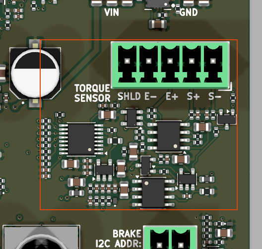

# torque_bridge_0_3v3_ina821

<!-- Generated by orb-weaver-kicad-board-docs from board-manifest.yaml; do not edit. -->

Block `orb_weaver_private:torque_bridge_0_3v3_ina821` placed in `/brake_torque_sensor` of **mouse-joystick-pcb**. RTS-5 bridge front end: 10 V excitation, INA821 gain 191.734, filtered full-scale ADC path and separate half-scale analog output.

|  |  |
| --- | --- |
| Lifecycle | routed |
| Family | none (a private block) |
| Placement | anchor (37, -18) mm, rotation 180°, front side |
| Sheet | `torque_bridge_0_3v3_ina821.kicad_sch`; sheet pins: the board's own arrangement |
| Drawing | [mouse-joystick-pcb-brake_torque_sensor-torque_bridge_0_3v3_ina821.svg](../schematic/mouse-joystick-pcb-brake_torque_sensor-torque_bridge_0_3v3_ina821.svg) |

## On the Board

Block 8 of the [board view](../board-view.md): 32.1 × 27.7 mm on the top side, its centre 31.9 mm right of and 7.7 mm above the board centre (X right, Y up, as the enclosure tables); 63 footprints. The picture is the top render clipped around the block, the rectangle the extent of its footprints' courtyards.

## Description

Single-channel torque sensor front end for a Transducer Techniques RTS-5 reaction bridge (350 ohm, 1.5 mV/V, 5 in-oz), giving a nominal 0.3540-1.3127 V ground-referenced rated-range analog output for a Neuropixels OneBox ADC channel, plus an on-board ADS8689 that streams the same conditioned signal at FULL amplitude. At the BNC, zero torque is nominally 0.8333 V; the fitted 259 ohm gain resistance gives INA821 gain 191.734. At 1.5 mV/V, +/-rated spans 0.3540-1.3127 V. The 1.577 mV/V sensor certificate at +/-150% overload predicts 0.0774-1.5892 V before tolerances. The ADC sees twice the unloaded BNC amplitude.
FULL DERIVATION, VALUES, LAYOUT RULES AND OPEN ITEMS ARE IN kicad-libs docs/torque-sensor-interface-design.md. This note carries only what breaks silently without it. Designators have changed across annotations, so the invariants below are also identified by NET.
1. EVERYTHING THAT LEAVES THE BOARD IS HALVED; THE ON-BOARD ADC IS NOT. A /2 divider (two 3.2k 0.1% 25ppm/C plus a 470 pF C0G midpoint shunt) sits in the TQ_AOUT leg only, between AMP_VOUT and the 249 ohm BNC resistor. TQ_AOUT_MON taps the divider midpoint so the scope tap reads what the BNC delivers. ADC_IN taps AMP_VOUT, so the MCU record and the OneBox record differ by exactly 2 and need TWO calibration constants. AMP_VOUT is the single reference node for both.
2. THE ADC's TAP MUST NOT MOVE TO THE MIDPOINT, and this is not obvious. The ADS8689's AIN_P is a RESISTIVE input, 1 MOhm +/-15% and range-programmable between 1 MOhm and 1.2 MOhm -- not a buffered high-Z input. On the midpoint it parallels the 3.2k bottom leg and becomes part of the ratio: BNC loading goes from -0.185% to -0.344%, the converter's input bias puts about +2.6 mV on the BNC (0.018 N.cm, ten times the sensor's 0.0018 N.cm nonrepeatability), and a firmware write changing the ADC's input range silently re-scales the OneBox reading. The bound the divider exists for does not apply to ADC_IN anyway: it never leaves the board, the ADC's range is 0-5.12 V, and its input protection is +/-20 V powered.
3. THE INA821's +VS BINDS TO VEXC, NOT +12V_FILT. That limits the INA821-driven pre-divider ceiling to about 3.283 V, or 1.642 V after division. It is NOT a universal output fault clamp: a downstream +5 V buffer rail fault at +2% can give about 2.55 V after division, and the ESD device does not clamp DC. Check the receiving input limits independently. Both nets are 10-12 V, both 'work', and ERC passes either way.
4. THE EXCITATION LOOP FEEDS BACK FROM VEXC AT THE CONNECTOR PIN, not from the emitter or the base node. From the emitter the 10 ohm isolation resistor's 286 mV drop goes uncorrected, a 2.9% sensitivity error. The 100k pull-down on VREF10 is what makes an open reference fail LOW instead of driving the ceiling to the 12 V rail.
5. TQ_AOUT, TQ_AOUT_MON AND ADC_IN ARE THREE DIFFERENT NETS AT TWO DIFFERENT SCALES. TQ_AOUT is the delivered output and carries the 249 ohm source resistor and the ESD clamp; verify on the netlist that the clamp shares a net with the connector pin. This was got wrong once already, on mouse-joystick-pcb.
6. TQ_AOUT HAS AN INA821-LIMITED CEILING OF ABOUT 1.642 V FROM A 1.849 kohm SOURCE AND NEEDS A >=1 Mohm LOAD. The source is the 249 ohm series resistor PLUS the divider's 1.6 kohm, not 249 ohm alone -- against the OneBox AD7616-P's 1 Mohm that is -0.185% of gain, systematic and absorbed by per-board calibration, but a 100 kohm load costs -1.82% and a 50 ohm terminated input reads a fraction of the correct value. The 249 ohm bounds a short of TQ_AOUT to ground at 6.6 mA and 11 mW inside a 62.5 mW 0402. The ESD clamp is a transient device and does NOT bound a DC fault.
7. THE RATIO RESISTORS ARE TWO SEPARATE MATCHED SETS AND THE BLOCK ALSO CONTAINS DECOYS. FIVE 10.0k ERA2AEB103X from one reel -- two for the /2 VMID midpoint, two in series for the /3 ADC divider top, one for its bottom. TWO 3.2k RT0402BRD073K2L from one reel for the output /2 divider. The block's two generic 10k pulls (R37011 reset pull-up, R37012 CIPO pull-down) are also 10k, and there are THREE 249 ohm parts -- the BNC series resistor, the ADC series resistor, and the 0.1% RG gain resistor. Identify every one of them by NET, never by value or by designator adjacency.
8. THE FILTER CAPACITORS MUST BE C0G, AND SO MUST THE 470 pF DIVIDER MIDPOINT SHUNT. Retune the filter by scaling BOTH capacitors by the same factor; the resistors set the DC gain and the whole mapping. Its 263 us group delay is deliberately matched to analog_output_0_3v3_dac80501's 266 us. The midpoint shunt is 470 pF because it adds only 0.75 us against that budget; 10 nF would add 16 us. Class-2 dielectric is piezoelectric, this board is coupled to a stepper and a hand-driven joystick, and on the divider midpoint that pickup becomes signal. A mechanically generated torque artifact in a torque measurement cannot be filtered out.
9. SPI: the saved circuit has a 10k pull-down on CIPO (SDO) and no fitted pull-up on TQ_CONVST_CS. Shared-bus idle termination belongs to the BOARD; repeated blocks duplicate the inherited CIPO pull and SCK/CIPO/COPI instrument taps. Resolve this ownership issue before reuse. The placing board defines SCK and COPI on the peripheral side of the default-open SN74CB3Q3245; the RP2040 end uses its own pad pull-downs.
10. SHUNT CALIBRATION IS NOT VERIFIED: TQ_CAL_EN drives the Q37001 gate directly, with no fitted gate pull-down; the only series part on that port is the 1k R37028 feeding the TQ_CAL_EN_INST tap. Its source is SIG_N, nominally near 5 V, so a 3.3 V GPIO cannot provide positive VGS. Arrange an appropriate drive and reset-safe gate bias in a separately reviewed circuit revision before relying on shunt calibration. It is a static enable, not an edge worth a logic-analyzer channel.
11. PWR_FLAG on +12V_FILT, +5V_FILT and VEXC is required, because ferrites and a pass transistor break driver propagation. GND is flagged once at board level, not here. Expect ERC to want one on the ADC's REFCAP and REFIO too: the official-derived symbol types REFCAP as power_in, matching upstream. Not a defect.
12. Bind +12V, +5V and +3.3V all to the SWITCHED domain. 0 V and the INA821-limited 1.642 V ceiling are out-of-band fault indications; other faults can exceed that ceiling. Two instances need separate sheets or their local nets merge.
13. CALIBRATION IS PER SENSOR AND PER BOARD, and the two channels are NOT interchangeable -- pair each sensor with a board serial and move its certificate constant with it. Fit the BNC and the ADC paths separately; do not derive one from the other by a factor of 2, because the divider's own 0.1% tolerance is part of the BNC gain. The sensor is the limit either way: 0.05% nonrepeatability is 0.001765 N.cm, which is 249 uV at the BNC after the divider (1.6 OneBox codes) and 6.4 LSB at the ADC's 78.125 uV.

## Ports

The brief's shape, edge, class and meaning for each port, then what the board wires it to.

| Port | Shape | Edge | Class | Wired to | Board net | Board class | GPIO | Meaning | On this board |
| --- | --- | --- | --- | --- | --- | --- | --- | --- | --- |
| `+3.3V` | passive | west | PWR_3V3_LOCAL | `+3.3V` | `/+3.3V_SW` | PWR_3V3 |  | Switched ADC digital supply; also biases reset high. |  |
| `+5V` | passive | west | PWR_5V_LOCAL | `+5V` | `/+5V_SW` | PWR_5V |  | Switched ADC analog / output-buffer supply. |  |
| `+12V` | passive | west | PWR_12V_LOCAL | `+12V` | `/brake_torque_sensor/+12V` | PWR_12V_LOCAL |  | Switched excitation / reference supply; keep above 10.75 V. |  |
| `CIPO` | output | west | Default | `TQ_SPI_CIPO` | `/TQ_SPI_CIPO` | Default | `GP12` | ADC serial data output; inherited 10k pull-down present. | Torque ADC SPI CIPO (`SPI1 RX`)⁷; in as the MCU sees it, via the bus switch |
| `CIPO_INST` | output | east | INSTRUMENT | `TQ_SPI_CIPO_INST` | `/TQ_SPI_CIPO_INST` | INSTRUMENT |  | 100 ohm isolated data-out monitor; shared-bus ownership issue. |  |
| `COPI` | input | west | Default | `TQ_SPI_COPI` | `/TQ_SPI_COPI` | Default | `GP11` | Host serial data input to ADC. | Torque ADC SPI COPI (`SPI1 TX`)⁷; out as the MCU sees it, via the bus switch |
| `COPI_INST` | output | east | INSTRUMENT | `TQ_SPI_COPI_INST` | `/TQ_SPI_COPI_INST` | INSTRUMENT |  | 100 ohm isolated data-in monitor; shared-bus ownership issue. |  |
| `GND` | passive | west | PWR_RETURN_LOCAL | `GND` | `/GND` | PWR_RETURN_LOCAL |  | Common return; keep bridge and shield currents out of input returns. |  |
| `SCK` | input | west | Default | `TQ_SPI_SCK` | `/TQ_SPI_SCK` | Default | `GP10` | Host serial clock to ADC. | Torque ADC SPI clock (`SPI1 SCK`)⁷; out as the MCU sees it, via the bus switch |
| `SCK_INST` | output | east | INSTRUMENT | `TQ_SPI_SCK_INST` | `/TQ_SPI_SCK_INST` | INSTRUMENT |  | 100 ohm isolated clock monitor; shared-bus ownership issue. |  |
| `TQ_AOUT` | output | east | Default | `TQ_AOUT` | `/brake_torque_sensor/TQ_AOUT` | Default |  | Half-scale analog output to external BNC; load >=1 Mohm, no 50 ohm termination. |  |
| `TQ_AOUT_MON` | output | east | Default | `TQ_AOUT_MON` | `/brake_torque_sensor/torque_bridge_0_3v3_ina821/TQ_AOUT_MON` | Default |  | Half-scale divider monitor through 1k; high-impedance probe. |  |
| `TQ_CAL_EN` | input | west | Default | `TQ_CAL_EN` | `/TQ_CAL_EN` | Default | `GP18` | Calibration FET gate; drive needs review (see group 1). No gate pull-down fitted. | Torque calibration enable⁷; out as the MCU sees it, via the bus switch |
| `TQ_CAL_EN_INST` | output | east | INSTRUMENT | `TQ_CAL_EN_INST` | `/TQ_CAL_EN_INST` | INSTRUMENT |  | 1k isolated calibration-gate monitor. |  |
| `TQ_CONVST_CS` | input | west | Default | `TQ_CONVST_CS` | `/TQ_CONVST_CS` | Default | `GP15` | ADC conversion / chip select; board must define idle state. | ADS8689 convert-start / frame, plain GPIO⁷; out as the MCU sees it, via the bus switch |
| `TQ_CONVST_CS_INST` | output | east | INSTRUMENT | `TQ_CONVST_CS_INST` | `/TQ_CONVST_CS_INST` | INSTRUMENT |  | 100 ohm isolated conversion / chip-select monitor. |  |

## Parts

As placed on the board's sheet; 63 of 63 paired with the brief's references by symbol identity, the rest given the brief's role where the internal part has one, else the catalog's role slug; the placement is the `Placement` field of the board's symbol, else of the library's (D38).

| Reference | Brief | Part | Value | Role | Placement |  |
| --- | --- | --- | --- | --- | --- | --- |
| `C2001` | `C37001` | `OW-CAP-100N-0402-X5R-16V` | 100nF | INA821 Vs+ bypass (VEXC), 100 nF | beside U2001.8 (Vs+), on VEXC |  |
| `C2002` | `C37002` | `OW-CAP-10N-0805-C0G-50V` | 10nF | VEXC input filter, 10 nF C0G |  |  |
| `C2003` | `C37003` | `OW-CAP-470P-0402-C0G-100V` | 470pF | IN_P shunt, 470 pF C0G | beside U2001.4 (+), on IN_P |  |
| `C2004` | `C37004` | `OW-CAP-10N-0805-C0G-50V` | 10nF | ATT_TAP filter shunt, 10 nF C0G |  |  |
| `C2005` | `C37005` | `OW-CAP-470P-0402-C0G-100V` | 470pF | IN_N shunt, 470 pF C0G | beside U2001.1 (-), on IN_N |  |
| `C2006` | `C37006` | `OW-CAP-10N-0805-C0G-50V` | 10nF | FILT_IN filter shunt, 10 nF C0G | beside U2005.3 (+), on FILT_IN |  |
| `C2007` | `C37007` | `OW-CAP-100N-0402-X5R-16V` | 100nF | Error amp U37003 V+ bypass, 100 nF | beside U2003.5 (V+), on +12V_FILT |  |
| `C2008` | `C37008` | `OW-CAP-10N-0805-C0G-50V` | 10nF | IN_P to IN_N differential, 10 nF C0G |  |  |
| `C2009` | `C37009` | `OW-CAP-100N-0402-X5R-16V` | 100nF | Output buffer U37005 V+ bypass | beside U2005.5 (V+), on +5V_FILT |  |
| `C2010` | `C37010` | `OW-CAP-100N-0402-X5R-16V` | 100nF | REF5010 Vin bypass, 100 nF | beside U2004.2 (Vin), on +12V_FILT |  |
| `C2011` | `C37011` | `OW-PASS-CL21A106KOQNNNE` | 10uF | ADC REFIO capacitor, 10 uF | beside U2002.4 (REFIO), on REFIO |  |
| `C2012` | `C37012` | `OW-PASS-CL21A106KOQNNNE` | 10uF | +12V_FILT rail bulk, 10 uF |  |  |
| `C2013` | `C37013` | `OW-PASS-CL21A106KOQNNNE` | 10uF | +5V_FILT rail bulk, 10 uF |  |  |
| `C2014` | `C37014` | `OW-PASS-CL21A106KOQNNNE` | 10uF | ADC REFCAP capacitor, 10 uF | beside U2002.6 (REFCAP), on REFCAP |  |
| `C2015` | `C37015` | `OW-CAP-100N-0402-X5R-16V` | 100nF | +12V_FILT rail bypass, 100 nF |  |  |
| `C2016` | `C37016` | `OW-CAP-100N-0402-X5R-16V` | 100nF | +5V_FILT rail bypass, 100 nF |  |  |
| `C2017` | `C37017` | `OW-PASS-CL05A105KL5NRNC` | 1uF | ADC REFCAP bypass, 1 uF, nearest pin | beside U2002.6 (REFCAP), on REFCAP |  |
| `C2018` | `C37018` | `OW-CAP-100N-0402-X5R-16V` | 100nF | ADC AVDD bypass, 100 nF | beside U2002.2 (AVDD), on +5V_FILT |  |
| `C2019` | `C37019` | `OW-PASS-CL05A105KL5NRNC` | 1uF | ADC DVDD bypass, 1 uF | beside U2002.16 (DVDD), on +3.3V |  |
| `C2020` | `C37020` | `OW-CAP-100N-0402-X5R-16V` | 100nF | ADC DVDD bypass, 100 nF | beside U2002.16 (DVDD), on +3.3V |  |
| `C2021` | `C37021` | `OW-PASS-CL05A105KL5NRNC` | 1uF | Reference output capacitor, 1 uF | beside U2004.6 (Vout), on VREF10 |  |
| `C2022` | `C37022` | `OW-CAP-470P-0402-C0G-100V` | 470pF | TQ_AOUT_DIV midpoint shunt, 470 pF |  |  |
| `C2023` | `C37023` | `OW-CAP-100N-0402-X5R-16V` | 100nF | VMID buffer U37006 V+ bypass | beside U2006.5 (V+), on +12V_FILT |  |
| `D2001` | `D37001` | `OW-MISC-TPD1E05U06DPYR` | TPD1E05U06DPYR | TQ_AOUT ESD clamp |  |  |
| `FB2001` | `FB37001` | `OW-PASS-FCM1608KF-601T03` | 600R@100MHz | +12V rail ferrite |  |  |
| `FB2002` | `FB37002` | `OW-PASS-FCM1608KF-601T03` | 600R@100MHz | +5V rail ferrite |  |  |
| `J2001` | `J37001` | `OW-CONN-TBH-1X05-3P5-VERT` | TBH-1x05-3.5mm | RTS-5 sensor terminal block |  |  |
| `Q2001` | `Q37001` | `OW-MISC-2SK1589-T1B-VB` | 2SK1589-T1B-VB | Shunt-calibration switch FET |  |  |
| `Q2002` | `Q37002` | `OW-MISC-MMBT5550LT1G` | MMBT5550LT1G | Excitation pass transistor |  |  |
| `R2001` | `R37001` | `OW-PASS-RT0402BRD07249RL` | 249 | INA821 gain resistor, 249 R 0.1% |  |  |
| `R2002` | `R37002` | `OW-PASS-RC0402FR-0710RL` | 10 | INA821 gain trim, 10 R |  |  |
| `R2003` | `R37003` | `OW-PASS-RT0402BRD0775KL` | 75k | Shunt-calibration resistor, 75 k |  |  |
| `R2004` | `R37004` | `OW-PASS-RC0402FR-071KL` | 1k | SIG_P input filter leg, 1 k |  |  |
| `R2005` | `R37005` | `OW-PASS-RC0402FR-071KL` | 1k | SIG_N input filter leg, 1 k |  |  |
| `R2006` | `R37006` | `OW-PASS-ERA2AEB103X` | 10k | ADC /3 divider top, INA_OUT side, 10 k |  |  |
| `R2007` | `R37007` | `OW-PASS-ERA2AEB103X` | 10k | ADC /3 divider top, ATT_TAP side, 10 k |  |  |
| `R2008` | `R37008` | `OW-PASS-ERA2AEB103X` | 10k | ADC /3 divider bottom, 10 k |  |  |
| `R2009` | `R37009` | `OW-PASS-0402WGF0000TCE` | 0 | Shield tie to GND, 0 R |  |  |
| `R2010` | `R37010` | `OW-RES-13K-0402-1PCT` | 13k | Low-pass filter series, 13 k |  |  |
| `R2011` | `R37011` | `OW-RES-10K-0402` | 10k | ~{RST} pull-up, 10 k | beside U2002.9 (~{RST}), on ~{RST} |  |
| `R2012` | `R37012` | `OW-RES-10K-0402` | 10k | CIPO pull-down, 10 k (inherited) | beside U2002.13 (SDO-0), on CIPO |  |
| `R2013` | `R37013` | `OW-PASS-RC0402FR-071KL` | 1k | Q37002 base resistor, 1 k |  |  |
| `R2014` | `R37014` | `OW-PASS-RC0402FR-0710RL` | 10 | Excitation isolation, 10 R |  |  |
| `R2015` | `R37015` | `OW-PASS-0603WAF1003T5E` | 100k | AMP_VOUT discharge, 100 k | beside U2005.1 (OUT), on AMP_VOUT |  |
| `R2016` | `R37016` | `OW-PASS-RT0402BRD073K2L` | 3.2k | Output /2 divider top, 3.2 k |  |  |
| `R2017` | `R37017` | `OW-PASS-ERA2AEB103X` | 10k | VMID divider top, 10 k |  |  |
| `R2018` | `R37018` | `OW-PASS-ERA2AEB103X` | 10k | VMID divider bottom, 10 k | beside U2006.3 (+), on VMID_TAP |  |
| `R2019` | `R37019` | `OW-PASS-0603WAF1003T5E` | 100k | VREF10 open-reference pull-down | beside U2003.3 (+), on VREF10 |  |
| `R2020` | `R37020` | `OW-PASS-RT0402BRD073K2L` | 3.2k | Output /2 divider bottom, 3.2 k |  |  |
| `R2021` | `R37021` | `OW-PASS-CRCW0402249RFKED` | 249 | TQ_AOUT series resistor, 249 R |  |  |
| `R2022` | `R37022` | `OW-PASS-RC0402FR-071KL` | 1k | TQ_AOUT_MON monitor tap, 1 k |  |  |
| `R2023` | `R37023` | `OW-PASS-CRCW0402249RFKED` | 249 | ADC_IN series resistor, 249 R |  |  |
| `R2024` | `R37024` | `OW-PASS-0402WGF1000TCE` | 100 | SCK instrument tap, 100 R |  |  |
| `R2025` | `R37025` | `OW-PASS-0402WGF1000TCE` | 100 | CIPO instrument tap, 100 R |  |  |
| `R2026` | `R37026` | `OW-PASS-0402WGF1000TCE` | 100 | COPI instrument tap, 100 R |  |  |
| `R2027` | `R37027` | `OW-PASS-0402WGF1000TCE` | 100 | CONVST_CS instrument tap, 100 R |  |  |
| `R2028` | `R37028` | `OW-PASS-RC0402FR-071KL` | 1k | TQ_CAL_EN_INST instrument tap, 1 k |  |  |
| `U2001` | `U37001` | `OW-MISC-INA821IDR` | INA821IDR | INA821 instrumentation amplifier |  |  |
| `U2002` | `U37002` | `OW-SENS-ADS8689IPWR` | ADS8689IPWR | ADS8689 16-bit SAR ADC |  |  |
| `U2003` | `U37003` | `OW-MISC-OPA197IDBVR` | OPA197IDBVR | Excitation error amplifier |  |  |
| `U2004` | `U37004` | `OW-PWR-REF5010AIDR` | REF5010AIDR | REF5010 10 V reference |  |  |
| `U2005` | `U37005` | `OW-MISC-OPA197IDBVR` | OPA197IDBVR | Filter output buffer |  |  |
| `U2006` | `U37006` | `OW-MISC-OPA197IDBVR` | OPA197IDBVR | VMID midpoint buffer |  |  |

## Operating Notes

- Signal path: SIG_P/SIG_N -> IN_P/IN_N -> INA_OUT -> ATT_TAP -> FILT_IN -> AMP_VOUT. ADC_IN reads full amplitude; TQ_AOUT and TQ_AOUT_MON read half amplitude.
- Ideal DC: INA_OUT = VEXC/2 + 191.734 x (SIG_P - SIG_N); AMP_VOUT = INA_OUT/3; unloaded TQ_AOUT = AMP_VOUT/2.
- At 10 V excitation, zero torque is 1.6667 V at AMP_VOUT and 0.8333 V at TQ_AOUT. Nominal +/-1.5 mV/V rated bridge output gives 0.3540-1.3127 V at TQ_AOUT.
- With the 1.577 mV/V sensor certificate, ideal +/-150% overload gives 0.0774-1.5892 V at TQ_AOUT. These are calculated values before tolerances and loading.
- Configure ADS8689 for 0-5.12 V; allow 20 ms for its reference, then allow bridge thermal settling. Fit ADC and analog-output calibration separately for each sensor / board / cable; tare before trials.
- The 1.642 V level is the documented upstream INA-limited ceiling, not a universal fault clamp. A buffer output short to a +5 V rail at +2% gives about 2.55 V after division; the ESD diode does not limit DC faults.

## Placement and Routing

### Sensor connector and calibration review

`J37001`, `R37009`, `C37002`, `R37003`, `Q37001`, `R37028`

Actual J37001 pinout: 1 SIG_N (white), 2 SIG_P (green), 3 VEXC (red), 4 GND (black), 5 shield. R37009 is the fitted 0 ohm shield tie. R37003/Q37001 are intended to shunt a bridge arm for calibration. CRITICAL REVIEW: Q37001 source is SIG_N, about 5 V. A ground-referenced 3.3 V gate gives Vgs about -1.7 V, so it cannot enable this N-channel FET as documented. No gate pull-down exists in this netlist.

- Place: Put input filtering beside J37001. Keep the shield tie at its ground pin.
- Route: Route SIG_P/SIG_N together with symmetric exposure to interference. Bring bridge -EXC back separately from noisy load returns.

### 10 V reference and excitation servo

`U37004`, `C37010`, `C37021`, `R37019`, `U37003`, `C37007`, `R37013`, `Q37002`, `R37014`

REF5010 supplies VREF10. U37003 drives Q37002 through R37013; the emitter feeds VEXC through 10 ohm R37014. Feedback senses VEXC after that resistor. A 350 ohm bridge draws 28.6 mA (286 mW). R37019 pulls an open reference low.

- Place: Keep reference / error amp together; separate pass-device heat from precision ratios. C37010 bypasses U37004; C37007 bypasses U37003.
- Route: Kelvin-route U37003.4 to VEXC at J37001.3. Sensing VEXC_DRV would leave the approximately 286 mV bridge-current drop uncompensated.
- Route: VEXC_B is the base node after R37013; VEXC_BASE is the op-amp output. Check loop stability with the actual cable and bypass load.

### Differential input filter and instrumentation gain

`R37004`, `R37005`, `C37003`, `C37005`, `C37008`, `U37001`, `R37001`, `R37002`, `C37001`

Matched 1k input legs with 470 pF shunts and 10 nF differential C37008 reject cable pickup. INA821 gain is 1 + 49.4k/(249+10) = 191.734. VMID sets the zero-torque output to 5 V.

- Place: Keep paired filter parts symmetric and close to the INA inputs; put R37001/R37002 beside gain pins 2/3. C37001 bypasses U37001.8.
- Route: U37001.8 must remain on VEXC. Moving it to +12V_FILT changes the output ceiling while passing ERC.
- Route: Keep IN_P/IN_N and the gain loop short, away from clocks, pass-transistor current and switching nodes; use C0G for the signal capacitors.

### Ratiometric 5 V midpoint

`R37017`, `R37018`, `U37006`, `C37023`

The equal 10k divider generates VMID_TAP = VEXC/2; U37006 buffers it onto VMID and the INA821 reference pin. C37023 bypasses the buffer supply.

- Place: Use R37017/R37018 from the same precision-resistor reel as R37006/R37007/R37008; keep matched resistors at similar temperature.
- Place: Put C37023 at U37006.5 (V+) with its GND end at pin 2 (V-).
- Route: Keep VMID_TAP local and clean. Route buffered VMID directly to U37001.6; avoid load and shield return currents at the divider ground.

### One-third attenuation, low-pass filter and buffer

`R37006`, `R37007`, `R37008`, `C37004`, `R37010`, `C37006`, `U37005`, `C37009`, `R37015`

Two series 10k resistors above ATT_TAP and one 10k below give DC gain 1/3. C37004 and C37006 are 10 nF C0G; R37010 is 13k. U37005 buffers FILT_IN onto AMP_VOUT; R37015 discharges its output. Ideal filter: -3 dB about 690 Hz, DC group delay about 263 us. Retune both capacitors together; resistor changes also change the mapping.

- Place: Cluster the divider and filter beside U37005. Keep the three precision 10k parts thermally close. Put C37009 at U37005.5.
- Route: Keep ATT_TAP/FILT_IN copper short and free of digital coupling. Limit stray capacitance under these high-impedance nodes.

### Half-scale analog output and monitor

`R37016`, `R37020`, `C37022`, `R37021`, `D37001`, `R37022`

Matched 3.2k R37016/R37020 divide AMP_VOUT by two. C37022 is 470 pF C0G (about 0.75 us added RC delay). TQ_AOUT leaves through 249 ohm R37021; the monitor leaves through 1k R37022.

- Place: Place the matched pair together. Put D37001 at the external-output entry/connector with a short return to its ground; the BNC is outside this block.
- Route: D37001 must share TQ_AOUT with the BNC pin, after R37021. The ESD return must not cross sensitive analog ground paths.
- Route: Output source resistance is 1.6k + 249 = 1.849 kohm: a 1 Mohm load costs about 0.185% gain. Leave ADC_IN on AMP_VOUT, not this divider midpoint.

### Full-amplitude ADC and its references

`R37023`, `U37002`, `R37011`, `R37012`, `C37011`, `C37014`, `C37017`, `C37018`, `C37019`, `C37020`

ADS8689 AIN_P reads AMP_VOUT through 249 ohm R37023. Its approximately 1 Mohm, range-dependent input resistance would disturb the half-scale divider if connected there. R37011 pulls reset high; R37012 is the inherited CIPO pull-down.

- Place: Put C37018 at AVDD and C37019/C37020 at DVDD. Put C37011 at REFIO; C37014/C37017 at REFCAP, with C37017 nearest the pin.
- Route: Use short reference-capacitor return loops and a continuous low-impedance local ground. Keep serial edges away from ADC_IN and both reference nodes.
- Route: REFIO/REFCAP serve this ADC only. Pins 14/15 are intentionally no-connect. CONVST_CS rising edge samples; falling edge starts the serial frame.

### Digital observation taps and bus ownership

`R37024`, `R37025`, `R37026`, `R37027`

100 ohm resistors isolate the SCK, CIPO, COPI and TQ_CONVST_CS monitor branches. The current circuit has no TQ_CONVST_CS pull-up. R37028 in group 1 similarly isolates the calibration-gate tap with 1k. INHERITED REVIEW: the shared SCK/CIPO/COPI taps and the CIPO pull-down belong once on the placing board; multiple copies parallel these loads. Keep this issue visible when reusing the block.

- Place: Place each tap resistor at its branch origin. Keep the main serial path direct; route observation branches toward the instrument connector.

### Filtered analog rails

`FB37001`, `C37012`, `C37015`, `FB37002`, `C37013`, `C37016`

FB37001 feeds +12V_FILT for the reference, excitation servo and midpoint buffer. FB37002 feeds +5V_FILT for the ADC and output buffer. Each filtered rail has 10 uF bulk plus 100 nF; per-IC bypass stays with its functional group.

- Place: Place bulk/bypass immediately after each ferrite at the block supply entry; keep high-current switching circuitry remote.
- Route: Keep the loop from each ferrite through its 10 uF and 100 nF to GND short.

### Block Notes

- Place sensor connector -> input filter / INA821 -> RC filter / buffer -> analog output along a quiet edge. Place the ADC toward the digital side.
- Keep motor/brake copper and the 12 V switching loop remote. Return bridge excitation and shield at the connector; do not share their current paths with input/filter returns.

## Checks

Instructions for review and testing, not evidence that they have run.

- As-drawn issues: no calibration gate pull-down or chip-select pull-up. R37012 and R37024/R37025/R37026 load or tap shared SPI lines; resolve board ownership before reuse.
- Verify harness pinout against J37001 on this sheet. Historical pin tables and GPIO calibration claims do not match this circuit.
- Bench-check excitation-loop stability with the real cable, switcher pickup, calibration switching, polarity and output loading. Connectivity checks do not establish analog performance.
- Declare supply drive for +12V, +5V and +3.3V at the board/harness boundary for ERC; the ferrites and Q37002 interrupt driver propagation, so the block flags +12V_FILT, +5V_FILT and VEXC itself. Put separate block instances on separate hierarchical sheets so their local nets do not merge.

## Library Identity

|  |  |
| --- | --- |
| Block | `orb_weaver_private:torque_bridge_0_3v3_ina821` |
| Resolution | the placed id is in the library |
| Brief | `design_blocks/orb_weaver_private.kicad_blocks/torque_bridge_0_3v3_ina821.kicad_block/torque_bridge_0_3v3_ina821.brief.yaml`, the block's brief |
| Published sheet | `452f8890ee8e9bc4` |
| Published PCB | `feeb93894d947e3e` |
| Source lock | symbol snapshot `ea4d626f523fe2db`, published 2026-10-14 |
| Placed sheet | `f623bad849df7720`: differs from the library's sheet; parts: the brief’s 63 by internal part; ports: the brief's |
| Netlist check | not run (`--brief-check`, kicad-cli) |

