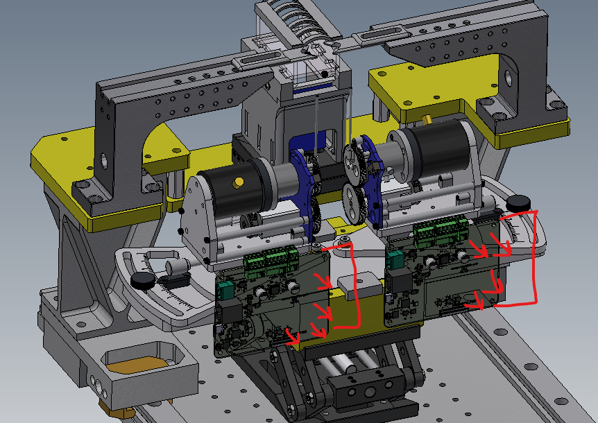

# Rig Layout

How a board sits in the rig and what plugs into each of its connectors. One
board drives one joystick; a rig has two joysticks, two boards and one
pyControl controller. The rig-level cabling, including the camera interface
board, the OneBox and the second rig at Peter's desk, is documented with the
rig itself in
[joystick-rig, `Hardware/rig-connections.md`](https://github.com/sourishmukh/joystick-rig/blob/main/Hardware/rig-connections.md);
this page is the board's side of it.

## Placement

A placement study from the two-joystick assembly model
([mouse-joysticks-mech](https://github.com/peterpolidoro/mouse-joysticks-mech)):
the two boards stand on their long edges under the motors, one per station,
with the terminal blocks toward the mechanism. The red marks are the
connector faces the enclosure has to leave reachable, which is what set the
connector positions, the 24 mm BNC spacing and the 7 mm mounting-hardware
clearances recorded in
[connector-access-2026-09-21.md](connector-access-2026-09-21.md) and in the
generated [connector locations](generated/mechanical/connectors.csv). Where
the boards finally mount is an enclosure decision; the model does not fix it.

## One Station

| Connector | What plugs in | Cable | Detail |
| --- | --- | --- | --- |
| `J301` RJ-45 | pyControl Breakout 1.2, port 1 for the left joystick or port 4 for the right | straight Ethernet patch cable; pins 1, 2, 4 and 6 are used | [pyControl port pinout](pycontrol-port-pinout.md) |
| `J201` USB-C | the rig's computer | USB-C | console and firmware load; also powers the MCU domain |
| `J501` 2-pos 5.08 mm | 36 V supply | two wires, polarity as marked on the silkscreen | [Power](power.md) |
| `J1102` 4-pos 3.5 mm | stepper coils | the station's harness | [Harness pinouts](harness-pinouts.md) |
| `J1103` 5-pos 3.5 mm | encoder: supply, return, A and B | the station's harness | same |
| `J1601` 2-pos 3.5 mm | limit switch | the station's harness | same |
| `J1801` 2-pos 3.5 mm | brake coil | two wires | [Interface map](interface-map.md) |
| `J2001` 5-pos 3.5 mm | torque sensor bridge: excitation, signal pair, ground and shield | five wires, shielded | [Interface map](interface-map.md), [sensor specifications](datasheets/torque-sensor-specs.png), [sensor wiring](datasheets/torque-sensor-wiring.png) |
| `J1101` BNC | angle, 0 to 3.3 V | coax to the OneBox or an oscilloscope | [OneBox analog interface](onebox-analog-interface.md) |
| `J901` BNC | torque, 0 to 3.3 V | coax | same |
| `J1301` 50-pin FFC | instrument port: 32 buffered digital taps for a logic analyzer | 0.5 mm FFC to the analyzer adapter | [Interface map](interface-map.md) |
| `SW601`, `SW602` | nothing; BOOTSEL and reset buttons | | |

The left and right stations differ only in the harness: the left joystick is
a mirror of the right one, so its motor and encoder cables carry two swaps
and the boards and firmware stay identical. Label the harnesses.

## Two Stations, One Controller

Both boards hang off the same Breakout 1.2, left on port 1 and right on
port 4, each over its own RJ-45. The two boards share the 36 V supply and
each has its own USB to the computer. The pyControl task talks to one board
per session and keeps a heartbeat to it; the board drops its motor rail
within 100 ms if the heartbeat stops. A board carries no left or right
state, and its serial, the RP2040 flash unique id, is what the firmware's
calibration table and the bring-up log key on.
